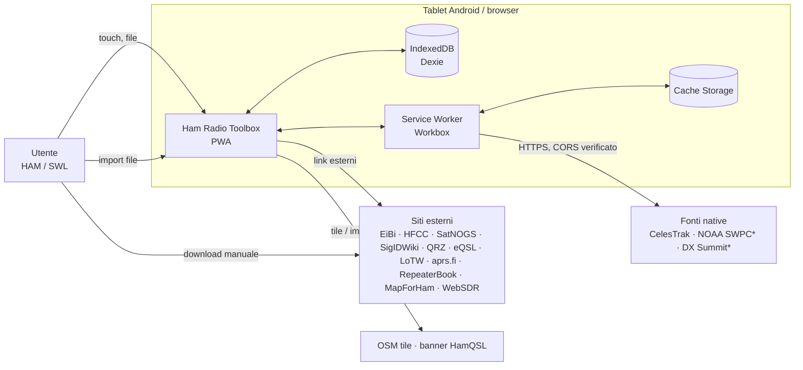

# Architettura — Ham Radio Toolbox v1

| Campo                | Valore                                                                                                                                                                         |
| -------------------- | ------------------------------------------------------------------------------------------------------------------------------------------------------------------------------ |
| Stato                | M0 — Approvato dal maintainer (2026-10-17)                                                                                                                                     |
| Ultimo aggiornamento | 2026-10-17                                                                                                                                                                     |
| Documenti collegati  | [Requisiti](../requirements/REQUIREMENTS.md) · [Database](DATABASE.md) · [Fonti dati](../data-sources/SOURCES.md) · [Roadmap](../roadmap/ROADMAP.md) · [ADR](../adr/README.md) |

---

## 1. Principi

1. **Local-first**: IndexedDB è la fonte di verità. La rete è un arricchimento, mai un prerequisito ([ADR-0003](../adr/0003-local-first-pwa-without-backend.md)).
2. **Dominio puro**: regole radio (bande, locator, RST/SINPO, calcoli RF, orbite) senza dipendenze da Vue, Dexie, `fetch` o API del browser ([ADR-0004](../adr/0004-layered-feature-modules.md)).
3. **Porte e adattatori**: l'applicazione dipende da interfacce; persistenza, fonti esterne e — in futuro — backend e controllo apparati sono adattatori sostituibili.
4. **Fonti esterne dichiarate**: ogni provider dichiara capacità, licenza, CORS, autenticazione e fallback ([ADR-0007](../adr/0007-external-provider-policy.md)).
5. **Validazione ai confini**: ogni dato che entra (form, import, restore, rete) passa da uno schema Zod.
6. **Leggerezza**: il target è un tablet; lazy loading per modulo, dipendenze minime e tree-shakeable.

---

## 2. Vista di contesto



`*` = da approvare (vedi [Fonti dati](../data-sources/SOURCES.md)). Nessun server proprio.

---

## 3. Layer e regole di dipendenza

```
presentation  →  application  →  domain
                      ↑
        infrastructure / providers
   (implementano le porte definite in application/domain)
```

| Layer                      | Contenuto                                                                                                        | Può importare                                                                | Non può importare                                              |
| -------------------------- | ---------------------------------------------------------------------------------------------------------------- | ---------------------------------------------------------------------------- | -------------------------------------------------------------- |
| **domain**                 | Entità, value object, regole e calcoli puri, schemi Zod delle entità, errori di dominio.                         | `core/` domain, `zod`                                                        | Vue, Pinia, Dexie, `fetch`, `window`, `navigator`, `shared/ui` |
| **application**            | Casi d'uso, porte (interfacce di repository, provider, clock, file, storage), DTO, orchestrazione import/export. | domain, `core/`                                                              | Vue, Dexie, infrastructure                                     |
| **infrastructure**         | Adattatori Dexie (repository, migrazioni), file I/O, storage, Web Worker, service worker.                        | application (porte), domain, `dexie`                                         | presentation                                                   |
| **providers**              | Adattatori verso fonti esterne (HTTP o parser di file importati).                                                | application (porte), domain                                                  | presentation, Dexie                                            |
| **presentation**           | Componenti Vue, viste, composable, store Pinia, route.                                                           | application (casi d'uso, DTO), domain (tipi, formattatori puri), `shared/ui` | infrastructure, providers, Dexie                               |
| **app** (composition root) | Bootstrap, creazione dei container, router, layout, registrazione PWA.                                           | tutto                                                                        | — (unico punto che conosce le implementazioni concrete)        |

**Applicazione automatica**: ESLint `no-restricted-imports` con pattern per percorso (es. vietato `dexie` fuori da `**/infrastructure/**`; vietato `**/infrastructure/**` da `**/presentation/**` e `**/domain/**`). Nessuna dipendenza aggiuntiva necessaria. Introdotto in M1, attivo per tutti i moduli.

**Comunicazione fra moduli**: un modulo usa un altro modulo solo tramite il suo `index.ts` pubblico (API dell'application layer). Esempio: il Logbook SWL chiede al Frequency Explorer `findScheduledAt(frequencyHz, at)` tramite una porta, mai leggendo direttamente la tabella `broadcast_schedules`.

---

## 4. Struttura del repository

Struttura confermata in M0 (sostituisce quella "indicativa" di `CLAUDE.md`):

```
src/
  app/                      # composition root
    main.ts                 # bootstrap (createApp, pinia, router, container)
    App.vue
    router.ts               # route lazy per modulo
    container.ts            # wiring porte → adattatori
    layout/                 # shell: header, nav, indicatore offline, toast aggiornamento
    pwa/                    # registrazione SW, prompt update/installazione
  shared/
    ui/                     # componenti UI generici (Button, Field, Dialog, DataTable, EmptyState…)
    i18n/                   # catalogo messaggi it, helper t(), formattatori Intl
    composables/            # useOnline, useAsyncState, useMediaQuery…
    utils/                  # utility generiche senza dominio radio
    types/                  # tipi comuni (Result, Brand…)
  core/                     # domain condiviso (puro)
    frequency/              # Hz, conversioni, band plan IARU R1
    locator/                # Maidenhead ↔ WGS84, distanza, azimut
    time/                   # UTC ISO, minuti del giorno, giorni settimana
    callsign/               # normalizzazione e validazione nominativi
    reports/                # RST, SINPO
    units/                  # dB, lunghezze, potenze
    validation/             # schemi Zod comuni (uuid, isoUtc, hz, lat/lon)
  modules/
    dashboard/
    ham-logbook/
      domain/               # QsoLog, regole duplicati, mapping ADIF
      application/          # use case (createQso, importAdif, exportAdif…), porte
      infrastructure/       # DexieQsoRepository, parser/writer ADIF
      presentation/         # viste, componenti, store Pinia
      index.ts              # API pubblica del modulo + definizione route
    swl-logbook/
    frequency-explorer/
    signal-explorer/
    satellite-explorer/
    resource-manager/
    dx-cluster/
    qsl-manager/
    aprs-explorer/
    repeater-explorer/
    rf-calculators/
    propagation/
    settings-backup/
  infrastructure/
    db/                     # AppDatabase (Dexie), versioni/migrazioni, repository base, transazioni
    providers/              # HttpClient, base provider, registry, rate limiting
    files/                  # lettura file, download, hashing, limiti dimensione
    workers/                # Web Worker (parsing grandi file, calcolo passaggi)
public/
  _headers                  # header HTTP per Cloudflare Pages (CSP, sicurezza) — da M1
tests/
  unit/                     # opzionale: i test unitari stanno accanto ai sorgenti (*.spec.ts)
  integration/              # repository Dexie con fake-indexeddb
  e2e/                      # Playwright
  fixtures/                 # file di test ridotti e anonimizzati (ADIF, EiBi, HFCC, TLE, Raindrop)
docs/
  PROJECT.md                # perimetro e obiettivi (riferimento primario)
  requirements/REQUIREMENTS.md
  architecture/ARCHITECTURE.md
  architecture/DATABASE.md
  data-sources/SOURCES.md
  roadmap/ROADMAP.md        # milestone + backlog
  adr/                      # NNNN-titolo.md
  references/               # materiale personale non versionato (.gitignore)
```

Note:

- Un modulo **senza** logica di dominio propria (es. `aprs-explorer` in v1, fatto di link e segnalibri) può avere solo i layer necessari; la struttura non va riempita con file vuoti.
- I test unitari stanno accanto al codice (`locator.spec.ts` vicino a `locator.ts`); integrazione ed E2E in `tests/`.
- Il materiale in `docs/references/` è escluso dal versionamento (vedi [§ 13](#13-verifica-di-coerenza-progetto--stack--repository)); le fixture di test derivate vanno create anonimizzate in `tests/fixtures/`.

---

## 5. Anatomia di un modulo

Esempio `ham-logbook`:

```
domain/
  qso.ts                 # schema Zod QsoLog + tipo, invarianti (banda derivata…)
  duplicate-policy.ts    # regola pura di duplicato
application/
  ports.ts               # QsoRepository, AdifCodec
  create-qso.ts          # use case: valida → arricchisce → repository.add
  import-adif.ts         # use case: parse → validate → preview → commit
  export-adif.ts
infrastructure/
  dexie-qso-repository.ts
  adif-codec.ts          # parser/writer ADIF (puro, testato)
presentation/
  views/QsoListView.vue
  views/QsoEditView.vue
  components/…
  store.ts               # Pinia: stato UI + chiamate ai use case
index.ts                 # export route + API pubblica
```

### 5.1 Casi d'uso

Funzioni o classi con dipendenze esplicite, nessuno stato globale:

```ts
// application/create-qso.ts (illustrativo)
export interface CreateQsoDeps {
  qsoRepository: QsoRepository;
  clock: Clock;
  ids: IdGenerator;
}

export function makeCreateQso(deps: CreateQsoDeps) {
  return async (input: QsoInput): Promise<Result<QsoLog, ValidationError>> => {
    /* parse con Zod → deriva banda → repository.add */
  };
}
```

### 5.2 Porte comuni (in `shared`/`core` application)

| Porta                                               | Scopo                                | Adattatore v1                                                          | Adattatore futuro                 |
| --------------------------------------------------- | ------------------------------------ | ---------------------------------------------------------------------- | --------------------------------- |
| `Repository<T>` (+ specializzazioni)                | CRUD, query, transazioni             | Dexie                                                                  | Sync con backend (Laravel)        |
| `UnitOfWork`                                        | Transazione multi-tabella            | `db.transaction('rw', …)`                                              | —                                 |
| `Clock`                                             | Ora corrente UTC                     | `Date`                                                                 | Fake nei test                     |
| `IdGenerator`                                       | UUID v4                              | `crypto.randomUUID()`                                                  | —                                 |
| `FilePicker` / `FileSaver`                          | Lettura e salvataggio file           | `<input type=file>` / download Blob; File System Access se disponibile | —                                 |
| `StorageInfo`                                       | Quota e persistenza                  | `navigator.storage`                                                    | —                                 |
| `GeoLocator`                                        | Posizione del dispositivo            | Geolocation API                                                        | —                                 |
| `DataProvider`                                      | Fonte esterna (vedi § 7)             | HTTP o parser file                                                     | Backend proxy autorizzato         |
| `RigControl` _(solo interfaccia, non implementata)_ | Lettura frequenza/modo dall'apparato | — (v1: nessuno)                                                        | Gateway CAT via backend/WebSerial |

La porta `RigControl` viene **solo dichiarata** quando servirà (non in v1), per non introdurre codice morto; la predisposizione consiste nel fatto che i form leggono frequenza/modo da una sorgente iniettabile.

### 5.3 Composition root e dependency injection

`app/container.ts` crea il database, gli adattatori e i casi d'uso, e li fornisce con `app.provide(KEY, container)`. Gli store Pinia ottengono i casi d'uso tramite `inject` (o una funzione `useContainer()`); i test sostituiscono il container. Nessun framework DI.

### 5.4 Stato e store Pinia

- Uno store per modulo (setup store), contiene **stato UI** (filtri, selezione, stato di caricamento) e chiama i casi d'uso.
- Gli store **non** importano Dexie e non duplicano il database in memoria: per liste grandi usano query paginate.
- Per viste reattive ai cambi del DB si usa `liveQuery` di Dexie **incapsulato** in un adattatore che espone un `Observable`/callback generico; la presentation non vede Dexie.

### 5.5 Gestione errori

- `Result<T, E>` per esiti attesi (validazione, duplicato, file non valido); eccezioni solo per errori inattesi.
- Errori di dominio tipizzati con `code` stabile → messaggio i18n in presentation.
- Un error boundary globale (`app.config.errorHandler`) mostra un toast e registra in console; nessuna telemetria.

---

## 6. Routing e navigazione

- Vue Router con route **lazy** per modulo (`component: () => import(...)`), una route radice per modulo (`/ham-logbook`, `/swl-logbook`, …) definita nel suo `index.ts`.
- History: **`createWebHistory()`** con base `/` ([ADR-0011](../adr/0011-static-hosting-and-routing.md), accettato). Online, le route profonde sono servite dal fallback SPA di Cloudflare Pages (nessun `404.html` nell'output); offline, dalla `NavigationRoute` del service worker.
- Layout responsive: barra di navigazione laterale su tablet in orizzontale/desktop, barra inferiore su schermi stretti.
- Moduli non ancora implementati: route presente con vista "In sviluppo — disponibile in Mx" (FR-GEN-07), nessun dato finto.

---

## 7. Fonti esterne: contratto dei provider

Ogni fonte è un adattatore registrato in un `ProviderRegistry` e descritto da metadati verificati in [SOURCES.md](../data-sources/SOURCES.md).

```ts
// Illustrativo: contratto da implementare in M5 (prima fonte)
export type AccessMode = "native" | "manual-import" | "link";

export interface ProviderDescriptor {
  key: string; // 'eibi', 'celestrak', …
  name: string;
  homepage: string;
  accessMode: AccessMode;
  license: { name: string; url?: string; attribution: string };
  cors: "verified" | "absent" | "unknown";
  auth: "none" | "personal-key" | "account";
  minRefreshIntervalMs?: number; // rispetto delle policy (es. CelesTrak 2 h)
  verifiedAt: string; // data ISO dell'ultima verifica
}

export interface ImportProvider<TRecord> {
  descriptor: ProviderDescriptor;
  accepts(file: File): boolean;
  parse(input: Blob, opts: ParseOptions): Promise<ParseReport<TRecord>>;
}

export interface RemoteProvider<TQuery, TRecord> {
  descriptor: ProviderDescriptor;
  fetch(
    query: TQuery,
    signal: AbortSignal,
  ): Promise<Result<FetchedData<TRecord>, ProviderError>>;
}

export interface FetchedData<T> {
  records: T[];
  fetchedAt: string; // UTC ISO
  sourceTimestamp?: string; // data del dato secondo la fonte
  kind?: "observed" | "forecast"; // propagazione
}
```

Regole del client HTTP condiviso:

- Solo HTTPS; nessuna intestazione con segreti; `AbortController` con timeout.
- Rispetto di `minRefreshIntervalMs` lato client (registrato in `data_sources`); nessun retry automatico su 4xx; backoff esponenziale con limite su 5xx/rete.
- Le risposte valide vengono validate con Zod, normalizzate (Hz, UTC, WGS84) e salvate in IndexedDB; il service worker **non** è la cache primaria dei dati (vedi § 8).
- Nessun proxy CORS ([ADR-0007](../adr/0007-external-provider-policy.md)).

---

## 8. PWA, service worker e strategia offline

Implementazione con `vite-plugin-pwa` (Workbox, modalità `generateSW`; `injectManifest` solo se servono logiche custom).

| Risorsa                                | Strategia                                                         | Note                                                                   |
| -------------------------------------- | ----------------------------------------------------------------- | ---------------------------------------------------------------------- |
| App shell (HTML, JS, CSS, font, icone) | **Precache** con revisioni                                        | Tutte le route funzionano offline                                      |
| Chunk dei moduli                       | Precache                                                          | Lazy loading senza perdere l'offline                                   |
| Dati delle fonti native (JSON)         | **Network-only** dal SW; persistenza in IndexedDB a cura dell'app | Evita doppia cache e dati "fantasma" senza metadati                    |
| Tile OSM                               | `StaleWhileRevalidate`, cache limitata (es. 500 voci, 7 giorni)   | Solo navigazione normale; **vietato** il prefetch massivo (policy OSM) |
| Banner HamQSL                          | `NetworkFirst` con fallback in cache (max 1 voce per URL, 6 h)    | Immagine, nessun CORS necessario                                       |
| Navigazioni                            | `NavigationRoute` → `index.html`                                  | Fallback SPA anche offline                                             |

- **Aggiornamento**: `registerType: 'prompt'`; quando c'è un nuovo SW in attesa compare un toast "Nuova versione disponibile — Aggiorna" (FR-DSH-08). Nessun `skipWaiting` silenzioso, per non cambiare versione durante l'inserimento di un QSO.
- **Manifest**: nome, `short_name`, icone (192, 512, maskable), `display: standalone`, `orientation: any`, `theme_color`/`background_color` coerenti con il tema scuro, `lang: it`.
- **Persistenza**: al primo avvio dopo l'installazione (o alla prima scrittura) `navigator.storage.persist()`; stato visibile in Impostazioni.
- **Cache HTTP**: Cloudflare Pages serve gli asset con `Cache-Control: public, max-age=0, must-revalidate` ed `ETag`, quindi `sw.js` e `index.html` vengono sempre rivalidati e gli aggiornamenti sono rilevati senza regole custom. Gli asset con hash restano comunque nel precache del SW.
- **Stato online**: composable `useOnline()` basato su eventi `online/offline` e sull'esito delle ultime richieste ai provider.

---

## 9. Persistenza

Dettagli completi in [DATABASE.md](DATABASE.md). In sintesi:

- Un'unica istanza `AppDatabase extends Dexie` in `src/infrastructure/db/`.
- Repository per aggregato nei moduli (`modules/*/infrastructure`), costruiti su helper comuni.
- Versioni di schema incrementali con `upgrade()` esplicito e test; mai modificare una versione rilasciata.
- Validazione Zod **prima** di ogni scrittura; i repository accettano solo entità già validate (tipi branded dove utile).
- Import atomici con `db.transaction('rw', [tabelle], …)`.
- Lavori pesanti (parsing di file grandi, calcolo passaggi) in **Web Worker** che restituiscono dati validati; la scrittura avviene nel thread principale in un'unica transazione (oppure nel worker con una sua connessione Dexie, scelta da fare in M5 misurando).

---

## 10. Presentation, UI e accessibilità

- Tailwind CSS v4 (plugin `@tailwindcss/vite`), design token come variabili CSS per tema chiaro/scuro (`class="dark"` su `<html>`, rispetto di `prefers-color-scheme`).
- Componenti `shared/ui` accessibili per costruzione: etichette associate, `aria-*` corretti, focus visibile, target ≥ 44 px, nessuna informazione veicolata solo dal colore.
- Formattazione di frequenze/date/unità tramite funzioni pure in `core` + `Intl` in `shared/i18n`.
- Mappe: Leaflet caricato **solo** nelle route che lo usano (import dinamico), attribuzione OSM sempre visibile.
- Nessun `v-html` con contenuti non sanificati; i testi importati sono sempre interpolati come testo.

### 10.1 i18n

Decisione **accettata** ([ADR-0008](../adr/0008-i18n-approach.md)): catalogo tipizzato (`shared/i18n/it.ts`) con chiavi verificate dal compilatore e funzione `t(key, params)`; pluralizzazione e formattazione via `Intl.PluralRules`/`Intl.NumberFormat`/`Intl.DateTimeFormat`. Nessuna dipendenza runtime.

---

## 11. Sicurezza

| Minaccia                                               | Contromisura                                                                                                                                                                                                                                                                                |
| ------------------------------------------------------ | ------------------------------------------------------------------------------------------------------------------------------------------------------------------------------------------------------------------------------------------------------------------------------------------- |
| XSS da file importati (HTML Raindrop, ADIF, CSV, JSON) | Parsing con `DOMParser` (documento inerte) o parser testuali; nessun `v-html`; validazione Zod; solo URL `http(s)`.                                                                                                                                                                         |
| File malevoli/enormi (DoS locale)                      | Limiti di dimensione per tipo di import, parsing in streaming/worker, limite al numero di errori riportati.                                                                                                                                                                                 |
| Esposizione di segreti                                 | Nessuna chiave nel bundle; variabili `VITE_*` limitate a configurazione pubblica; controllo in CI (grep di pattern di chiavi).                                                                                                                                                              |
| Injection via CSV export (formula injection)           | Prefisso `'` per celle che iniziano con `= + - @` nell'export CSV.                                                                                                                                                                                                                          |
| Script/iframe di terzi                                 | CSP: `default-src 'self'`; `img-src 'self' data: blob: https://tile.openstreetmap.org https://www.hamqsl.com`; `connect-src 'self'` + fonti native approvate; nessun `unsafe-eval`. Header impostati in `public/_headers` (Cloudflare Pages, max 100 regole, max 2 000 caratteri per riga). |
| Supply chain                                           | Lockfile versionato, `npm ci`, `npm audit` in CI, dipendenze minime, Dependabot.                                                                                                                                                                                                            |
| Privacy                                                | Nessuna telemetria; nessun caricamento automatico di risorse remote da dati importati (es. copertine Raindrop).                                                                                                                                                                             |

---

## 12. Qualità, test e CI

| Livello      | Strumento                                                                                  | Ambito                                                                                       |
| ------------ | ------------------------------------------------------------------------------------------ | -------------------------------------------------------------------------------------------- |
| Typecheck    | `vue-tsc --noEmit`                                                                         | Tutto `src/` e test                                                                          |
| Lint/format  | ESLint (flat config, `eslint-plugin-vue`, `typescript-eslint`, regole di layer) + Prettier | Tutto                                                                                        |
| Unit         | Vitest                                                                                     | `core/`, `modules/*/domain`, parser/codec, calcolatori, migrazioni (con fake-indexeddb)      |
| Integrazione | Vitest + `fake-indexeddb` + jsdom                                                          | Repository Dexie, use case end-to-end senza UI, backup/restore                               |
| Componenti   | Vitest + `@vue/test-utils`                                                                 | Componenti `shared/ui` critici, form                                                         |
| E2E          | Playwright (Chromium desktop + emulazione tablet Android)                                  | Flussi principali, offline (`context.setOffline(true)`), installabilità, accessibilità (axe) |
| Manuale      | Checklist su tablet Android reale                                                          | Installazione, offline, persistenza, prestazioni                                             |

Pipeline GitHub Actions (introdotta in M1):

1. `npm ci`
2. `npm run typecheck` · `npm run lint` · `npm run format -- --check`
3. `npm run test -- --coverage` (soglie su domain critico)
4. `npm run build`
5. `npm run test:e2e` sulla build (`vite preview`)
6. Deploy su **Cloudflare Pages** (Direct Upload) con `cloudflare/wrangler-action@v4` → `pages deploy dist --project-name=ham-radio-toolbox`, solo da `main` e solo se tutti i passi sono verdi. Prima del deploy, un controllo fa fallire la pipeline se `dist/404.html` esiste, perché disattiverebbe il fallback SPA.

### 12.1 Deployment (Cloudflare Pages)

Configurazione verificata sulla documentazione ufficiale il 2026-10-17 ([ADR-0011](../adr/0011-static-hosting-and-routing.md)); la prova con un deploy reale è un criterio di M1.

| Voce                  | Valore                                                                                                         |
| --------------------- | -------------------------------------------------------------------------------------------------------------- |
| Progetto              | `ham-radio-toolbox`, modalità Direct Upload                                                                    |
| Output                | `dist/` (build Vite)                                                                                           |
| Fallback SPA          | Automatico in assenza di `404.html` di primo livello                                                           |
| Header                | `public/_headers` → `dist/_headers`                                                                            |
| Secret GitHub Actions | `CLOUDFLARE_API_TOKEN` (permesso _Account › Cloudflare Pages › Edit_), `CLOUDFLARE_ACCOUNT_ID`; mai nel bundle |
| Dominio               | `*.pages.dev` (dominio personalizzato opzionale)                                                               |
| Limiti rilevanti      | 20 000 file, 25 MiB per asset (piano gratuito)                                                                 |

---

## 13. Verifica di coerenza: progetto ↔ stack ↔ repository

Verifica eseguita in M0 (2026-10-17) confrontando `PROJECT.md`, `CLAUDE.md` e il contenuto reale del repository.

### 13.1 Coerenti

| Elemento                                                          | Stato                                                                                                                                                                                                                               |
| ----------------------------------------------------------------- | ----------------------------------------------------------------------------------------------------------------------------------------------------------------------------------------------------------------------------------- |
| Stack di `PROJECT.md` §4 e di `CLAUDE.md`                         | Allineati (Vue 3, TS strict, Vite, Router, Pinia, Tailwind, Dexie, Zod, Workbox/vite-plugin-pwa, Leaflet/OSM, satellite.js, Vitest, Playwright, ESLint, Prettier, GitHub Actions).                                                  |
| 14 moduli MOD-01…MOD-14 ↔ cartelle `src/modules/*` di `CLAUDE.md` | Corrispondenza 1:1.                                                                                                                                                                                                                 |
| Milestone M0…M13                                                  | Stesso ordine e contenuto in entrambi i documenti.                                                                                                                                                                                  |
| Dipendenze installate                                             | `vue` 3.5.44, `vue-router` 5.4.0, `pinia` 4.1.0, `dexie` 4.4.6, `zod` 4.6.7, `vite` 8.3.4, `vite-plugin-pwa` 2.0.0 (peer `vite ^8` supportato), `tailwindcss` 4.3.3, `vitest` 5.0.5, `@playwright/test` 1.64.1, `typescript` 6.0.3. |
| TypeScript strict                                                 | `strict: true` ereditato da `@vue/tsconfig`.                                                                                                                                                                                        |

### 13.2 Divergenze e lacune (da risolvere nella milestone indicata)

| #    | Divergenza                                                                                                                                                                                                                                     | Impatto                               | Azione                                                                                                                                                                                                                                                | M           |
| ---- | ---------------------------------------------------------------------------------------------------------------------------------------------------------------------------------------------------------------------------------------------- | ------------------------------------- | ----------------------------------------------------------------------------------------------------------------------------------------------------------------------------------------------------------------------------------------------------- | ----------- |
| D-01 | `CLAUDE.md` indica `docs/architecture.md`, `data-model.md`, `data-sources.md`, `backlog.md`; il repository ha `docs/requirements/`, `docs/architecture/{ARCHITECTURE,DATABASE}.md`, `docs/data-sources/SOURCES.md`, `docs/roadmap/ROADMAP.md`. | Documentazione                        | Adottata la struttura del repository; `CLAUDE.md` aggiornato ([ADR-0002](../adr/0002-documentation-layout.md)). Il backlog vive in `ROADMAP.md`.                                                                                                      | M0 ✅       |
| D-02 | Mancano dipendenze dello stack: `eslint` (+ `eslint-plugin-vue`, `typescript-eslint`, `eslint-config-prettier`), `leaflet` (+ `@types/leaflet`), `satellite.js`, `fake-indexeddb`.                                                             | Stack incompleto                      | Aggiungere quando servono: ESLint in M1, `fake-indexeddb` in M2, `satellite.js` in M8, `leaflet` in M8.                                                                                                                                               | M1–M8       |
| D-03 | Nessuna libreria i18n nello stack, ma `CLAUDE.md` impone "sistema i18n".                                                                                                                                                                       | Decisione mancante                    | **Risolta**: catalogo tipizzato interno ([ADR-0008](../adr/0008-i18n-approach.md), accettato). Implementazione in M1.                                                                                                                                 | M0 ✅       |
| D-04 | Script `typecheck`, `lint`, `format`, `test`, `test:e2e` mancanti in `package.json`.                                                                                                                                                           | Comandi di `CLAUDE.md` non eseguibili | Definirli in M1.                                                                                                                                                                                                                                      | M1          |
| D-05 | `vite.config.ts` registra solo `@vitejs/plugin-vue`: mancano `@tailwindcss/vite`, `VitePWA`, alias `@/`, configurazione Vitest.                                                                                                                | PWA e Tailwind non attivi             | M1.                                                                                                                                                                                                                                                   | M1          |
| D-06 | `src/` contiene lo scaffold di Vite (`HelloWorld.vue`, `hero.png`, `vue.svg`, `vite.svg`, `style.css`).                                                                                                                                        | Codice dimostrativo                   | Rimuovere in M1.                                                                                                                                                                                                                                      | M1          |
| D-07 | `index.html` ha `lang="en"` e titolo `ham-radio-toolbox`; manca manifest/theme-color.                                                                                                                                                          | UI italiana, PWA                      | `lang="it"`, titolo, meta PWA in M1.                                                                                                                                                                                                                  | M1          |
| D-08 | `README.md` è quello del template Vite.                                                                                                                                                                                                        | Documentazione                        | Riscritto in M0.                                                                                                                                                                                                                                      | M0 ✅       |
| D-09 | `.gitignore` esclude `docs/references/` → `Ham_Radio.html` (200 segnalibri, 2 cartelle annidate) non è versionato, mentre `PROJECT.md` lo cita come collezione iniziale. `*.local` è ripetuto.                                                 | Fixture M9, riproducibilità           | Mantenere l'esclusione (dati personali); creare in M9 una fixture anonimizzata in `tests/fixtures/raindrop/`. Rimuovere la riga duplicata in M1.                                                                                                      | M1 / M9     |
| D-10 | Repository git con remote GitHub `ToninoCode/ham-radio-toolbox`; documenti M0 committati in `08f2d66`. Mancano CI e deploy.                                                                                                                    | CI                                    | GitHub Actions + deploy Cloudflare Pages in M1 (BL-M1-12, BL-M1-13).                                                                                                                                                                                  | M1          |
| D-11 | Il locator Maidenhead e la distanza servono già nel Logbook HAM (M3, validazione e campi), ma i "calcolatori e locator" sono in M6.                                                                                                            | Dipendenza fra milestone              | Il **dominio** `core/locator` si implementa in M2/M3; M6 realizza solo l'interfaccia dei calcolatori.                                                                                                                                                 | M2–M3       |
| D-12 | La gestione QSL compare in MOD-02 (stato QSL) e in MOD-09 (QSL Manager, M10).                                                                                                                                                                  | Duplicazione dati                     | Unica fonte di verità: tabella `qsl_records`, definita in M2, popolata dall'import ADIF in M3, gestita in UI in M10.                                                                                                                                  | M2–M10      |
| D-13 | Il pannello "freschezza dati" è richiesto nella dashboard (M1) ma le fonti arrivano da M5.                                                                                                                                                     | Rischio di dati finti                 | In M1 il pannello mostra solo lo stato vuoto ("Nessuna fonte importata").                                                                                                                                                                             | M1          |
| D-14 | EiBi e HFCC sono serviti **solo in HTTP** (HTTPS non risponde, verificato) e senza CORS; da una PWA HTTPS il fetch è bloccato (mixed content).                                                                                                 | Integrazione impossibile da browser   | Solo import manuale + link (FR-FRQ-01/02). HFCC resta Must, con le dipendenze di formato, licenza e fattibilità di [Requisiti § 4.4.1](../requirements/REQUIREMENTS.md#441-dipendenze-dellimport-hfcc) ([ADR-0012](../adr/0012-hfcc-in-v1-scope.md)). | M5          |
| D-15 | `PROJECT.md` cita HamQSL come fonte di propagazione: l'XML non ha CORS. Per valori numerici serve un'altra fonte.                                                                                                                              | Perimetro fonti                       | Proposta NOAA SWPC ([ADR-0010](../adr/0010-noaa-swpc-propagation-source.md)), da approvare.                                                                                                                                                           | M12         |
| D-16 | Le mappe offline non sono realizzabili con le tile pubbliche OSM (policy).                                                                                                                                                                     | Aspettativa offline                   | Mappe solo online; vista polare/tabellare offline per i satelliti.                                                                                                                                                                                    | M8 / M11    |
| D-17 | Il CTCSS ha valori decimali (88,5 Hz) in contrasto con "frequenze in Hz interi".                                                                                                                                                               | Convenzione dati                      | Eccezione documentata: toni in decimi di Hz interi ([ADR-0005](../adr/0005-data-conventions.md)).                                                                                                                                                     | M2          |
| D-18 | `noUncheckedIndexedAccess` non attivo (consigliato per parser e accesso ad array).                                                                                                                                                             | Robustezza tipi                       | Abilitarlo in M1 in `tsconfig.app.json`.                                                                                                                                                                                                              | M1          |
| D-19 | Versione in `package.json` `0.0.0` vs `PROJECT.md` "Version 1.0.0".                                                                                                                                                                            | Nessuno (1.0.0 è il target)           | Usare SemVer `0.x` fino alla release v1.0 in M13.                                                                                                                                                                                                     | M13         |
| D-20 | `PROJECT.md` §10 (e, fino alla chiusura di M0, `CLAUDE.md`) stima 16 settimane; le stime del backlog (171 h per M1–M13) più la riserva del 23 % portano a ≈ 211 h, cioè circa 21 settimane a 11 h/settimana.                                   | Calendario                            | `PROJECT.md` dichiara il calendario provvisorio e da raffinare: aggiornati `ROADMAP.md` § 2 e `CLAUDE.md`; il perimetro non cambia. Allineare `PROJECT.md` §10 quando lo decide il maintainer.                                                        | M0 ✅ (doc) |
| D-21 | Hosting: `CLAUDE.md` diceva genericamente "hosting statico HTTPS".                                                                                                                                                                             | Deploy                                | Cloudflare Pages ([ADR-0011](../adr/0011-static-hosting-and-routing.md)); `CLAUDE.md` aggiornato.                                                                                                                                                     | M0 ✅       |

---

## 14. Evoluzione futura (senza riscrivere il frontend)

| Evoluzione (PROJECT §13)                     | Punto di estensione già previsto                                                                                                                                              |
| -------------------------------------------- | ----------------------------------------------------------------------------------------------------------------------------------------------------------------------------- |
| Backend Laravel opzionale / sincronizzazione | Porte `Repository`; campi `updatedAt` su ogni entità; ID UUID generati dal client (nessun conflitto di chiavi). Un futuro `SyncService` affiancherà Dexie, non lo sostituirà. |
| Packaging Capacitor                          | App 100 % statica, nessuna dipendenza da API server; storage IndexedDB compatibile con WebView.                                                                               |
| CAT tramite gateway radio                    | Porta `RigControl` da dichiarare in quel momento; i form leggono frequenza/modo da una sorgente iniettabile.                                                                  |
| SDR streaming, decodifica digitale           | Moduli nuovi in `src/modules/`; nessun impatto sui moduli esistenti.                                                                                                          |
| Integrazioni QSL/DX avanzate                 | Nuovi adattatori `RemoteProvider` dietro backend autorizzato (credenziali mai nel frontend).                                                                                  |
