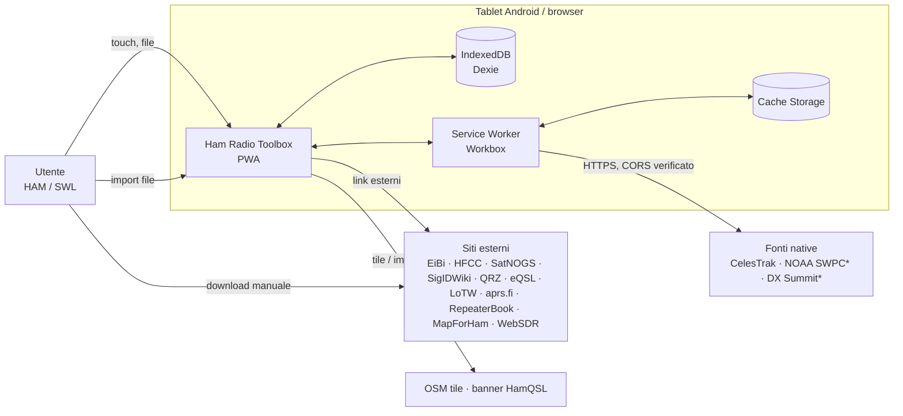

# Architettura — Ham Radio Toolbox v1

| Campo                | Valore                                                                                                                                                                         |
| -------------------- | ------------------------------------------------------------------------------------------------------------------------------------------------------------------------------ |
| Stato                | M0 approvato (2026-10-17) · aggiornato con l'implementazione M1 (v0.1.0, 2026-10-17) e M2 Blocchi A–B (persistenza, 2026-10-24)                                                |
| Ultimo aggiornamento | 2026-10-24                                                                                                                                                                     |
| Documenti collegati  | [Requisiti](../requirements/REQUIREMENTS.md) · [Database](DATABASE.md) · [Fonti dati](../data-sources/SOURCES.md) · [Roadmap](../roadmap/ROADMAP.md) · [ADR](../adr/README.md) |

---

## 1. Principi

1. **Local-first**: IndexedDB è la fonte di verità. La rete è un arricchimento, mai un prerequisito ([ADR-0003](../adr/0003-local-first-pwa-without-backend.md)).
2. **Dominio puro**: regole radio (bande, locator, RST/SINPO, calcoli RF, orbite) senza dipendenze da Vue, Dexie, `fetch` o API del browser ([ADR-0004](../adr/0004-layered-feature-modules.md)).
3. **Porte e adattatori**: l'applicazione dipende da interfacce; persistenza, fonti esterne e — in futuro — backend e controllo apparati sono adattatori sostituibili.
4. **Fonti esterne dichiarate**: ogni provider dichiara capacità, licenza, CORS, autenticazione e fallback ([ADR-0007](../adr/0007-external-provider-policy.md)).
5. **Validazione ai confini**: ogni dato che entra (form, import, restore, rete) passa da uno schema Zod.
6. **Leggerezza**: il target è un tablet; lazy loading per modulo, dipendenze minime e tree-shakeable.

---

## 2. Vista di contesto



`*` = da approvare (vedi [Fonti dati](../data-sources/SOURCES.md)). Nessun server proprio.

---

## 3. Layer e regole di dipendenza

```
presentation  →  application  →  domain
                      ↑
        infrastructure / providers
   (implementano le porte definite in application/domain)
```

| Layer                      | Contenuto                                                                                                        | Può importare                                                                                       | Non può importare                                              |
| -------------------------- | ---------------------------------------------------------------------------------------------------------------- | --------------------------------------------------------------------------------------------------- | -------------------------------------------------------------- |
| **domain**                 | Entità, value object, regole e calcoli puri, schemi Zod delle entità, errori di dominio.                         | `core/` domain, `zod`, `shared/types` ([ADR-0013](../adr/0013-core-domain-types-and-validation.md)) | Vue, Pinia, Dexie, `fetch`, `window`, `navigator`, `shared/ui` |
| **application**            | Casi d'uso, porte (interfacce di repository, provider, clock, file, storage), DTO, orchestrazione import/export. | domain, `core/`                                                                                     | Vue, Dexie, infrastructure                                     |
| **infrastructure**         | Adattatori Dexie (repository, migrazioni), file I/O, storage, Web Worker, service worker.                        | application (porte), domain, `dexie`                                                                | presentation                                                   |
| **providers**              | Adattatori verso fonti esterne (HTTP o parser di file importati).                                                | application (porte), domain                                                                         | presentation, Dexie                                            |
| **presentation**           | Componenti Vue, viste, composable, store Pinia, route.                                                           | application (casi d'uso, DTO), domain (tipi, formattatori puri), `shared/ui`                        | infrastructure, providers, Dexie                               |
| **app** (composition root) | Bootstrap, creazione dei container, router, layout, registrazione PWA.                                           | tutto                                                                                               | — (unico punto che conosce le implementazioni concrete)        |

**Porte comuni** (M2, [ADR-0014](../adr/0014-repositories-unit-of-work-and-persistence-errors.md)): `src/shared/application/` è il layer application condiviso dai moduli (errori di persistenza, `UnitOfWork`, `Clock`, `IdGenerator`, `ContentHasher`, `DatabaseLifecycle`, repository delle entità condivise, contratti di import, backup e storage). Ha le restrizioni dell'application (niente Dexie, Vue, infrastructure, API del browser) più quelle di `shared` (nessun modulo); domain e `core` non possono importarlo.

**Applicazione automatica**: ESLint `no-restricted-imports` con pattern per percorso (es. vietato `dexie` fuori da `**/infrastructure/**`; vietato `**/infrastructure/**` da `**/presentation/**` e `**/domain/**`), più la regola locale `hrt/no-cross-boundary-relative-import` (`eslint/`): un import relativo non può uscire dal proprio modulo o dalla propria area (`app`, `shared`, `core`, `infrastructure`), quindi ogni attraversamento passa dall'alias `@/` dove valgono le regole di layer. Nessuna dipendenza aggiuntiva. Introdotto in M1, attivo per tutti i moduli e verificato da test negativi (`tests/integration/eslint-layer-rules.spec.ts`).

**Comunicazione fra moduli**: un modulo usa un altro modulo solo tramite il suo `index.ts` pubblico (API dell'application layer). Esempio: il Logbook SWL chiede al Frequency Explorer `findScheduledAt(frequencyHz, at)` tramite una porta, mai leggendo direttamente la tabella `broadcast_schedules`.

---

## 4. Struttura del repository

Struttura confermata in M0 (sostituisce quella "indicativa" di `CLAUDE.md`):

```
src/
  app/                      # composition root
    main.ts                 # bootstrap (createApp, pinia, router, container)
    App.vue
    router.ts               # route lazy per modulo
    modules.ts              # registro dei manifest dei 14 moduli → catalogo fornito con provide (M1)
    container.ts            # wiring porte → adattatori, APP_CONTAINER_KEY / useContainer() (M2)
    layout/                 # shell: header, nav, indicatore offline, toast aggiornamento
    theme/                  # preferenza tema sistema/chiaro/scuro (store Pinia) e applicazione al documento
    views/                  # viste di sistema: "In sviluppo" (FR-GEN-07), pagina non trovata
    pwa/                    # registrazione SW (virtual:pwa-register/vue) e notifiche di aggiornamento/offline
  shared/
    ui/                     # componenti UI generici (Button, Field, Dialog, DataTable, EmptyState…)
    i18n/                   # catalogo messaggi it, helper t(), formattatori Intl
    modules/                # contratto ModuleManifest, catalogo dei moduli e injection key
    composables/            # useOnline, useAsyncState, useMediaQuery…
    utils/                  # utility generiche senza dominio radio (stripUndefined, M2)
    types/                  # tipi comuni: Result, Brand (M2, ADR-0013)
    application/            # porte comuni: errori di persistenza, UnitOfWork, Clock, IdGenerator, ContentHasher, repository condivisi, contratti import/backup/storage (M2, ADR-0014); pipeline di import generica (M2, Blocco C)
  core/                     # domain condiviso (puro)
    frequency/              # Hz, conversioni, band plan IARU R1
    locator/                # Maidenhead ↔ WGS84, distanza, azimut
    time/                   # UTC ISO, minuti del giorno, giorni settimana, formati compatti ADIF
    callsign/               # normalizzazione e validazione nominativi
    reports/                # RST, SINPO
    units/                  # dB, lunghezze, potenze (non ancora creato: vedi ROADMAP, M2 questioni aperte)
    validation/             # schemi Zod comuni costruiti sulle funzioni di dominio (uuid, UTC, Hz, lat/lon, locator, nominativo, RST/SINPO, metadati, testo); configurazione Zod senza eval
    attachment/             # schema degli allegati, nomi file sicuri, tipi MIME ammessi (M2)
    import-job/             # schema dei job di import, conteggi, errori troncati a 500 (M2)
    data-source/            # stato locale delle fonti esterne (M2)
  modules/
    dashboard/
    ham-logbook/
      domain/               # QsoLog, regole duplicati, mapping ADIF
      application/          # use case (createQso, importAdif, exportAdif…), porte
      infrastructure/       # DexieQsoRepository, parser/writer ADIF
      presentation/         # viste, componenti, store Pinia
      index.ts              # API pubblica del modulo + definizione route
    swl-logbook/
    frequency-explorer/
    signal-explorer/
    satellite-explorer/
    resource-manager/
    dx-cluster/
    qsl-manager/
    aprs-explorer/
    repeater-explorer/
    rf-calculators/
    propagation/
    settings-backup/
  infrastructure/
    db/                     # AppDatabase (Dexie), versioni (schema.ts), migrazioni pure (migrations/), errori, UnitOfWork, integrità, repository delle entità condivise (repositories/), gateway del backup (M2, Blocco C)
    providers/              # HttpClient, base provider, registry, rate limiting
    files/                  # lettura file di import, hashing (SHA-256 Web Crypto e incrementale), base64, JSON canonico (M2), limiti dimensione
    system/                 # orologio di sistema e generatore di UUID (adattatori di Clock e IdGenerator, M2)
    workers/                # Web Worker (parsing grandi file, calcolo passaggi)
public/
  _headers                  # header HTTP per Cloudflare Pages (CSP, sicurezza) — da M1
  favicon.svg, icons/       # icone PWA generate da scripts/generate-pwa-icons.mjs (npm run icons)
scripts/                    # script di sviluppo (icone PWA, controlli sulla build)
eslint/                     # regole ESLint locali (confini fra moduli, BL-M1-16)
.github/                    # workflow CI/CD, Dependabot, ruleset di main
tests/
  cloudflare/               # comportamento dell'hosting: header, fallback SPA, CSP (wrangler pages dev o URL reale)
  unit/                     # opzionale: i test unitari stanno accanto ai sorgenti (*.spec.ts)
  integration/              # repository Dexie con fake-indexeddb (db/), pipeline di import (import/), backup e restore (backup/), container, regole ESLint
  browser/                  # pagine harness eseguite da Playwright in Chromium reale (backup-harness/, M2)
  e2e/                      # Playwright
  fixtures/                 # file di test ridotti e anonimizzati (ADIF, EiBi, HFCC, TLE, Raindrop); backup/ con i backup v1 da ripristinare a ogni versione (M2)
docs/
  PROJECT.md                # perimetro e obiettivi (riferimento primario)
  requirements/REQUIREMENTS.md
  architecture/ARCHITECTURE.md
  architecture/DATABASE.md
  data-sources/SOURCES.md
  roadmap/ROADMAP.md        # milestone + backlog
  adr/                      # NNNN-titolo.md
  references/               # materiale personale non versionato (.gitignore)
```

Note:

- Ogni modulo esporta da `index.ts` un `manifest` (`ModuleManifest`: percorso, area HAM/SWL/condivisa, workspace, icona, chiavi i18n, disponibilità o milestone prevista, vista lazy). `app/modules.ts` li aggrega; router, navigazione e dashboard li leggono dal catalogo iniettato, senza importare gli altri moduli (introdotto in M1).
- Un modulo **senza** logica di dominio propria (es. `aprs-explorer` in v1, fatto di link e segnalibri) può avere solo i layer necessari; la struttura non va riempita con file vuoti.
- I test unitari stanno accanto al codice (`locator.spec.ts` vicino a `locator.ts`); integrazione ed E2E in `tests/`.
- Il materiale in `docs/references/` è escluso dal versionamento (vedi [§ 13](#13-verifica-di-coerenza-progetto--stack--repository)); le fixture di test derivate vanno create anonimizzate in `tests/fixtures/`.

---

## 5. Anatomia di un modulo

Esempio `ham-logbook`:

```
domain/
  qso.ts                 # schema Zod QsoLog + tipo, invarianti (banda derivata…)
  duplicate-policy.ts    # regola pura di duplicato
application/
  ports.ts               # QsoRepository, AdifCodec
  create-qso.ts          # use case: valida → arricchisce → repository.add
  import-adif.ts         # use case: parse → validate → preview → commit
  export-adif.ts
infrastructure/
  dexie-qso-repository.ts
  adif-codec.ts          # parser/writer ADIF (puro, testato)
presentation/
  views/QsoListView.vue
  views/QsoEditView.vue
  components/…
  store.ts               # Pinia: stato UI + chiamate ai use case
index.ts                 # export route + API pubblica
```

### 5.1 Casi d'uso

Funzioni o classi con dipendenze esplicite, nessuno stato globale:

```ts
// application/create-qso.ts (illustrativo)
export interface CreateQsoDeps {
  qsoRepository: QsoRepository;
  clock: Clock;
  ids: IdGenerator;
}

export function makeCreateQso(deps: CreateQsoDeps) {
  return async (input: QsoInput): Promise<Result<QsoLog, ValidationError>> => {
    /* parse con Zod → deriva banda → repository.add */
  };
}
```

### 5.2 Porte comuni (in `shared`/`core` application)

| Porta                                               | Scopo                                | Adattatore v1                                                          | Adattatore futuro                 |
| --------------------------------------------------- | ------------------------------------ | ---------------------------------------------------------------------- | --------------------------------- |
| `Repository<T>` (+ specializzazioni)                | CRUD, query, transazioni             | Dexie                                                                  | Sync con backend (Laravel)        |
| `UnitOfWork`                                        | Transazione multi-tabella            | `db.transaction('rw', …)`                                              | —                                 |
| `Clock`                                             | Ora corrente UTC                     | `Date`                                                                 | Fake nei test                     |
| `IdGenerator`                                       | UUID v4                              | `crypto.randomUUID()`                                                  | —                                 |
| `FilePicker` / `FileSaver`                          | Lettura e salvataggio file           | `<input type=file>` / download Blob; File System Access se disponibile | —                                 |
| `StorageInfo`                                       | Quota e persistenza                  | `navigator.storage`                                                    | —                                 |
| `GeoLocator`                                        | Posizione del dispositivo            | Geolocation API                                                        | —                                 |
| `DataProvider`                                      | Fonte esterna (vedi § 7)             | HTTP o parser file                                                     | Backend proxy autorizzato         |
| `RigControl` _(solo interfaccia, non implementata)_ | Lettura frequenza/modo dall'apparato | — (v1: nessuno)                                                        | Gateway CAT via backend/WebSerial |

Implementate in M2 (Blocco B), in `src/shared/application/` o nell'application del modulo proprietario: repository di profili stazione, impostazioni, QSO, ricezioni SWL (con dettagli), QSL, allegati, fonti dati e job di import; `UnitOfWork` (`DexieUnitOfWork`); `Clock` (`systemClock`); `IdGenerator` (`cryptoIdGenerator`); `ContentHasher` (`webCryptoContentHasher`); `DatabaseLifecycle` (`AppDatabase`).

Blocco C ([ADR-0015](../adr/0015-backup-format-and-atomic-restore.md)): pipeline di import generica (`createImportPipeline`, con le porte `ImportFormat`, `ImportTarget` implementate dai moduli da M3 e `ImportFileReader` → `blobImportFileReader`); `BackupGateway` → `DexieBackupGateway` (snapshot, stato locale, scrittura atomica del restore, migrazioni pure); nel modulo `settings-backup` la porta `BackupCodec` (formato v1, `jsonBackupCodec`) e i casi d'uso `BackupService`. Resta solo contratto `StorageInfo` (Blocco D).

La porta `RigControl` viene **solo dichiarata** quando servirà (non in v1), per non introdurre codice morto; la predisposizione consiste nel fatto che i form leggono frequenza/modo da una sorgente iniettabile.

### 5.3 Composition root e dependency injection

`app/container.ts` crea il database, gli adattatori e i casi d'uso, e li fornisce con `app.provide(KEY, container)`. Gli store Pinia ottengono i casi d'uso tramite `inject` (o una funzione `useContainer()`); i test sostituiscono il container. Nessun framework DI.

Stato M2: `createContainer(options)` crea `AppDatabase` (aperto in modo pigro alla prima operazione, oppure con `connect()`, che riporta il motivo di un'apertura fallita), `DexieUnitOfWork`, i repository e le porte di sistema; `main.ts` lo fornisce con `APP_CONTAINER_KEY`. Le opzioni permettono ai test di usare un IndexedDB isolato, un orologio e un generatore di id propri. Il container importa direttamente gli adattatori in `modules/*/infrastructure` (eccezione consentita al solo composition root, § 3). Il servizio di backup e restore si ottiene con `loadBackupService()`, che carica con un import dinamico `app/backup-wiring.ts` (codec, gateway e casi d'uso in un chunk separato, ADR-0015).

### 5.4 Stato e store Pinia

- Uno store per modulo (setup store), contiene **stato UI** (filtri, selezione, stato di caricamento) e chiama i casi d'uso.
- Gli store **non** importano Dexie e non duplicano il database in memoria: per liste grandi usano query paginate.
- Per viste reattive ai cambi del DB si usa `liveQuery` di Dexie **incapsulato** in un adattatore che espone un `Observable`/callback generico; la presentation non vede Dexie.

### 5.5 Gestione errori

- `Result<T, E>` per esiti attesi (validazione, duplicato, file non valido); eccezioni solo per errori inattesi.
- Errori di dominio tipizzati con `code` stabile → messaggio i18n in presentation.
- Un error boundary globale (`app.config.errorHandler`) mostra un toast e registra in console; nessuna telemetria.
- Persistenza (M2): i repository restituiscono `Result<T, PersistenceError>` con sei codici (`persistence.not-found`, `invalid-input`, `conflict`, `transaction-failed`, `quota-exceeded`, `unavailable`) e dettagli stabili (`reason`, `rule`, issue `{ path, code }`). Solo i guasti dello storage e dell'ambiente diventano errori attesi; le altre eccezioni si propagano ([ADR-0014](../adr/0014-repositories-unit-of-work-and-persistence-errors.md)).

---

## 6. Routing e navigazione

- Vue Router con route **lazy** per modulo (`component: () => import(...)`), una route radice per modulo (`/ham-logbook`, `/swl-logbook`, …) definita nel suo `index.ts`.
- History: **`createWebHistory()`** con base `/` ([ADR-0011](../adr/0011-static-hosting-and-routing.md), accettato). Online, le route profonde sono servite dal fallback SPA di Cloudflare Pages (nessun `404.html` nell'output); offline, dalla `NavigationRoute` del service worker.
- Layout responsive: barra di navigazione laterale su tablet in orizzontale/desktop, barra inferiore su schermi stretti.
- Moduli non ancora implementati: route presente con vista "In sviluppo — disponibile in Mx" (FR-GEN-07), nessun dato finto.

---

## 7. Fonti esterne: contratto dei provider

Ogni fonte è un adattatore registrato in un `ProviderRegistry` e descritto da metadati verificati in [SOURCES.md](../data-sources/SOURCES.md).

```ts
// Illustrativo: contratto da implementare in M5 (prima fonte)
export type AccessMode = "native" | "manual-import" | "link";

export interface ProviderDescriptor {
  key: string; // 'eibi', 'celestrak', …
  name: string;
  homepage: string;
  accessMode: AccessMode;
  license: { name: string; url?: string; attribution: string };
  cors: "verified" | "absent" | "unknown";
  auth: "none" | "personal-key" | "account";
  minRefreshIntervalMs?: number; // rispetto delle policy (es. CelesTrak 2 h)
  verifiedAt: string; // data ISO dell'ultima verifica
}

export interface ImportProvider<TRecord> {
  descriptor: ProviderDescriptor;
  accepts(file: File): boolean;
  parse(input: Blob, opts: ParseOptions): Promise<ParseReport<TRecord>>;
}

export interface RemoteProvider<TQuery, TRecord> {
  descriptor: ProviderDescriptor;
  fetch(
    query: TQuery,
    signal: AbortSignal,
  ): Promise<Result<FetchedData<TRecord>, ProviderError>>;
}

export interface FetchedData<T> {
  records: T[];
  fetchedAt: string; // UTC ISO
  sourceTimestamp?: string; // data del dato secondo la fonte
  kind?: "observed" | "forecast"; // propagazione
}
```

Regole del client HTTP condiviso:

- Solo HTTPS; nessuna intestazione con segreti; `AbortController` con timeout.
- Rispetto di `minRefreshIntervalMs` lato client (registrato in `data_sources`); nessun retry automatico su 4xx; backoff esponenziale con limite su 5xx/rete.
- Le risposte valide vengono validate con Zod, normalizzate (Hz, UTC, WGS84) e salvate in IndexedDB; il service worker **non** è la cache primaria dei dati (vedi § 8).
- Nessun proxy CORS ([ADR-0007](../adr/0007-external-provider-policy.md)).

---

## 8. PWA, service worker e strategia offline

Implementazione con `vite-plugin-pwa` (Workbox, modalità `generateSW`; `injectManifest` solo se servono logiche custom).

| Risorsa                                | Strategia                                                         | Note                                                                   |
| -------------------------------------- | ----------------------------------------------------------------- | ---------------------------------------------------------------------- |
| App shell (HTML, JS, CSS, font, icone) | **Precache** con revisioni                                        | Tutte le route funzionano offline                                      |
| Chunk dei moduli                       | Precache                                                          | Lazy loading senza perdere l'offline                                   |
| Dati delle fonti native (JSON)         | **Network-only** dal SW; persistenza in IndexedDB a cura dell'app | Evita doppia cache e dati "fantasma" senza metadati                    |
| Tile OSM                               | `StaleWhileRevalidate`, cache limitata (es. 500 voci, 7 giorni)   | Solo navigazione normale; **vietato** il prefetch massivo (policy OSM) |
| Banner HamQSL                          | `NetworkFirst` con fallback in cache (max 1 voce per URL, 6 h)    | Immagine, nessun CORS necessario                                       |
| Navigazioni                            | `NavigationRoute` → `index.html`                                  | Fallback SPA anche offline                                             |

- **Aggiornamento**: `registerType: 'prompt'`; quando c'è un nuovo SW in attesa compare un toast "Nuova versione disponibile — Aggiorna" (FR-DSH-08). Nessun `skipWaiting` silenzioso, per non cambiare versione durante l'inserimento di un QSO.
- **Manifest**: nome, `short_name`, icone (192, 512, maskable), `display: standalone`, `orientation: any`, `theme_color`/`background_color` coerenti con il tema scuro, `lang: it`.
- **Persistenza**: al primo avvio dopo l'installazione (o alla prima scrittura) `navigator.storage.persist()`; stato visibile in Impostazioni.
- **Cache HTTP**: Cloudflare Pages serve per default `Cache-Control: public, max-age=0, must-revalidate` ed `ETag`, quindi `index.html` e le route vengono sempre rivalidati. `public/_headers` aggiunge `no-cache` esplicito per `sw.js` e `immutable` per gli asset con hash (`/assets/*`, `/workbox-*.js`); dettaglio in § 12.1. Gli asset con hash restano comunque nel precache del SW.
- **Stato online**: composable `useOnline()` basato su eventi `online/offline` e sull'esito delle ultime richieste ai provider.

### 8.1 Implementazione (M1, BL-M1-11)

Configurazione in `vite.config.ts`, registrazione in `src/app/pwa/`. Nessun service worker scritto a mano: Workbox lo genera dalla configurazione.

| Voce                    | Valore                                                                                                                                                                                                                            |
| ----------------------- | --------------------------------------------------------------------------------------------------------------------------------------------------------------------------------------------------------------------------------- |
| Plugin                  | `vite-plugin-pwa` 2.0, `strategies: 'generateSW'`, `registerType: 'prompt'`, `injectRegister: false` (registrazione da `virtual:pwa-register/vue`)                                                                                |
| Manifest                | `name` e `description` dal catalogo i18n (`app.name`, `app.tagline`), `short_name` "Ham Toolbox", `id`/`start_url`/`scope` `/`, `display: standalone`, `orientation: any`, `lang: it`, `theme_color`/`background_color` `#0b1120` |
| Icone                   | `public/icons/icon-192.png`, `icon-512.png` (`purpose: any`), `icon-maskable-512.png` (`maskable`, glifo nella zona sicura), `apple-touch-icon-180.png`, `public/favicon.svg`; generate con `npm run icons`                       |
| Precache                | `globPatterns: **/*.{js,css,html,svg,png}` + manifest: shell, tutti i chunk lazy dei moduli, CSS, icone. Ogni voce ha una revisione; `cleanupOutdatedCaches` elimina le cache Workbox delle versioni precedenti                   |
| Navigazioni             | `navigateFallback: 'index.html'`: ogni route (anche mai visitata o inesistente → pagina 404 dell'app) si apre offline                                                                                                             |
| Runtime caching         | **Nessuno** in M1: non esistono fonti esterne. Le righe "Dati delle fonti native", "Tile OSM" e "Banner HamQSL" della tabella § 8 si attuano in M5/M8/M12                                                                         |
| Attivazione             | Primo avvio: `clientsClaim` (la pagina è subito controllata). Aggiornamenti: `skipWaiting: false`, il nuovo SW resta in attesa finché l'utente non sceglie "Aggiorna"                                                             |
| Controllo aggiornamenti | All'avvio (registrazione) e ogni 60 minuti se online (`registration.update()`), per le sessioni lunghe su tablet                                                                                                                  |
| Identificativo build    | `<meta name="build-id">` da `HRT_BUILD_ID` (in CI lo SHA del commit, in locale `local`), per diagnostica e test                                                                                                                   |

**Flusso di aggiornamento** (`PwaUpdatePrompt.vue`, avviso flottante non modale in una regione `aria-live`; gli avvisi informativi e di errore sono in `PwaStatus.vue`, **nel flusso della pagina** sopra il contenuto, così non coprono mai i controlli sugli schermi piccoli):

1. il SW nuovo si installa in background e resta _in attesa_; compare "Nuova versione disponibile" con **Aggiorna** e **Più tardi**;
2. _Più tardi_ nasconde l'avviso: la versione in uso non cambia, e l'avviso ricompare al successivo avvio finché il SW è in attesa;
3. _Aggiorna_ attiva il SW in attesa e ricarica la pagina sulla nuova versione;
4. al primo avvio compare, in testa alla pagina, "App pronta per l'uso offline" (si chiude da sola dopo 10 s o con il pulsante);
5. errori di registrazione o di aggiornamento compaiono in testa alla pagina come avviso (`role="alert"`) chiudibile.

**Dati**: il service worker gestisce solo le proprie cache (Cache Storage, prefisso `workbox-precache`). Non legge né modifica IndexedDB e non memorizza risposte di terzi, credenziali o contenuti privati. Aggiornare l'app non tocca i dati dell'utente; le migrazioni di schema restano compito di Dexie (M2).

**Test automatici** (Playwright sulla build servita da `vite preview`):

- `tests/e2e/pwa.spec.ts`: manifest e icone (dimensioni e tipo reali), assenza di errori di manifest e installabilità secondo Chrome (CDP `Page.getInstallabilityErrors`), registrazione e scope del SW, precache solo same-origin, offline completo: ricarica della dashboard, accesso diretto a tutte le route lazy, ricarica di una route interna, 404, nessun errore in console;
- `tests/e2e/pwa-update.spec.ts`: due build reali (`HRT_BUILD_ID` v1 e v2) su un server dedicato, prompt, rinvio, ricarica, conferma e passaggio a v2;
- unit test in `src/app/pwa/pwa.spec.ts` e `tests/integration/pwa-assets.spec.ts`.

**Limitazioni note**

- Playwright emula Chrome per Android (viewport, touch, user agent) su Chromium desktop: non verifica il prompt di installazione reale, la modalità standalone, lo splash screen né il ritaglio dell'icona maskable del launcher. Servono le verifiche manuali di § 8.2.
- `context.setOffline` simula l'assenza di rete del browser, non la modalità aereo del sistema operativo.
- La quota e l'eventuale eliminazione dei dati da parte del browser dipendono da `navigator.storage.persist()`, che arriva con M2.
- Safari/iOS: best effort (NFR-CMP-02); l'icona Apple è presente, ma il comportamento non è verificato.
- La prima visita richiede la rete: l'offline è disponibile solo dopo che il precache è completo (avviso "pronta per l'uso offline").

### 8.2 Collaudo manuale su tablet Android

Da eseguire su un tablet reale con Chrome stabile, sull'URL HTTPS di Cloudflare Pages (dopo BL-M1-13) oppure, in rete locale, sulla build servita con `npm run preview -- --host` raggiunta tramite `chrome://inspect` e port forwarding (`localhost` è un contesto sicuro, un IP di rete locale no). Annotare data, modello, versione di Android e di Chrome e il `build-id` (Strumenti per sviluppatori o sorgente della pagina).

| #   | Verifica                                                                                                     | Esito atteso                                                                                                       |
| --- | ------------------------------------------------------------------------------------------------------------ | ------------------------------------------------------------------------------------------------------------------ |
| 1   | Apri l'URL, attendi "App pronta per l'uso offline".                                                          | Avviso visibile, nessun errore.                                                                                    |
| 2   | Menu ⋮ → _Installa app_ (o _Aggiungi a schermata Home_).                                                     | Nome "Ham Toolbox", icona con antenna non tagliata.                                                                |
| 3   | Avvia dall'icona.                                                                                            | Splash scuro, app a schermo intero senza barra degli indirizzi (standalone).                                       |
| 4   | Ruota il tablet in verticale e in orizzontale su dashboard e su un modulo.                                   | Sidebar a icone in verticale, sidebar completa in orizzontale; nessuno scroll orizzontale.                         |
| 5   | Attiva la modalità aereo, chiudi l'app dal multitasking, riaprila.                                           | Dashboard visibile, indicatore "Offline".                                                                          |
| 6   | Offline: apri tutti i 13 moduli dalla navigazione, torna indietro con il gesto di sistema.                   | Ogni modulo mostra "In sviluppo"; il gesto indietro riporta alla pagina precedente.                                |
| 7   | Offline: ricarica una pagina interna (trascina verso il basso, se disponibile, o riapri l'app su un modulo). | La pagina si riapre.                                                                                               |
| 8   | Disattiva la modalità aereo.                                                                                 | Indicatore "Online" entro pochi secondi.                                                                           |
| 9   | Pubblica una nuova build, riapri l'app installata.                                                           | "Nuova versione disponibile"; _Più tardi_ la nasconde; _Aggiorna_ ricarica sulla nuova build (`build-id` diverso). |
| 10  | Tema: Sistema/Chiaro/Scuro dal menu.                                                                         | Colori e barra di stato coerenti.                                                                                  |

Esito e anomalie si registrano nella checklist di chiusura della milestone (ROADMAP, consuntivo).

---

## 9. Persistenza

Dettagli completi in [DATABASE.md](DATABASE.md). In sintesi:

- Un'unica istanza `AppDatabase extends Dexie` in `src/infrastructure/db/`.
- Repository per aggregato nei moduli (`modules/*/infrastructure`), costruiti su helper comuni.
- Versioni di schema incrementali con `upgrade()` esplicito e test; mai modificare una versione rilasciata.
- Validazione Zod **prima** di ogni scrittura; i repository accettano solo entità già validate (tipi branded dove utile).
- Import atomici con `db.transaction('rw', [tabelle], …)`.
- **Implementazione M2** ([ADR-0014](../adr/0014-repositories-unit-of-work-and-persistence-errors.md)): schemi delle entità `strictObject` nel domain del modulo proprietario; repository Dexie in `modules/*/infrastructure` (profili stazione, impostazioni, QSO, ricezioni SWL con dettagli, QSL) e in `infrastructure/db/repositories` (allegati, fonti dati, job di import); validazione e normalizzazione con lo schema prima di ogni scrittura; integrità e cascate di DATABASE § 6 nella stessa transazione; `UnitOfWork` su tutte le tabelle per le operazioni multi-repository; database più recente dell'app rifiutato; eventi `versionchange`/`blocked` esposti dalla porta `DatabaseLifecycle`.
- Dentro una transazione si attendono solo operazioni IndexedDB: lettura di file, hashing e `fetch` avvengono prima (IndexedDB chiude la transazione appena attende altro, lasciando committate le scritture precedenti).
- **Import e backup (M2, Blocco C)**: pipeline generica parse → validazione → anteprima → commit unico con il job (DATABASE § 8.1); backup JSON v1 scritto e letto in modo progressivo, con checksum per tabella, e restore atomico in una `UnitOfWork` (DATABASE § 9, [ADR-0015](../adr/0015-backup-format-and-atomic-restore.md)). Limite operativo del backup: 100 MB.
- Lavori pesanti (parsing di file grandi, calcolo passaggi) in **Web Worker** che restituiscono dati validati; la scrittura avviene nel thread principale in un'unica transazione (oppure nel worker con una sua connessione Dexie, scelta da fare in M5 misurando).

---

## 10. Presentation, UI e accessibilità

- Tailwind CSS v4 (plugin `@tailwindcss/vite`), design token come variabili CSS per tema chiaro/scuro (`class="dark"` su `<html>`, rispetto di `prefers-color-scheme`).
- Componenti `shared/ui` accessibili per costruzione: etichette associate, `aria-*` corretti, focus visibile, target ≥ 44 px, nessuna informazione veicolata solo dal colore.
- Formattazione di frequenze/date/unità tramite funzioni pure in `core` + `Intl` in `shared/i18n`.
- Mappe: Leaflet caricato **solo** nelle route che lo usano (import dinamico), attribuzione OSM sempre visibile.
- Nessun `v-html` con contenuti non sanificati; i testi importati sono sempre interpolati come testo.

### 10.1 i18n

Decisione **accettata** ([ADR-0008](../adr/0008-i18n-approach.md)): catalogo tipizzato (`shared/i18n/it.ts`) con chiavi verificate dal compilatore e funzione `t(key, params)`; pluralizzazione e formattazione via `Intl.PluralRules`/`Intl.NumberFormat`/`Intl.DateTimeFormat`. Nessuna dipendenza runtime.

---

## 11. Sicurezza

| Minaccia                                               | Contromisura                                                                                                                                                                                                                                                                                                                                                                                                                                                                                                                                                                                                                                                                                                                                           |
| ------------------------------------------------------ | ------------------------------------------------------------------------------------------------------------------------------------------------------------------------------------------------------------------------------------------------------------------------------------------------------------------------------------------------------------------------------------------------------------------------------------------------------------------------------------------------------------------------------------------------------------------------------------------------------------------------------------------------------------------------------------------------------------------------------------------------------ |
| XSS da file importati (HTML Raindrop, ADIF, CSV, JSON) | Parsing con `DOMParser` (documento inerte) o parser testuali; nessun `v-html`; validazione Zod; solo URL `http(s)`.                                                                                                                                                                                                                                                                                                                                                                                                                                                                                                                                                                                                                                    |
| File malevoli/enormi (DoS locale)                      | Limiti di dimensione per tipo di import, parsing in streaming/worker, limite al numero di errori riportati. Backup (M2): lettura progressiva senza `JSON.parse` dell'intero file, limiti per file (100 MB), record e membri dell'intestazione, decodifica UTF-8 stretta, checksum per tabella, schemi `strictObject` (nessun campo o chiave fuori contratto, `__proto__` compreso), nessuna scrittura prima della conferma.                                                                                                                                                                                                                                                                                                                            |
| Esposizione di segreti                                 | Nessuna chiave nel bundle; variabili `VITE_*` limitate a configurazione pubblica; `npm run check:dist` in CI cerca pattern di chiavi e credenziali nei file pubblicati.                                                                                                                                                                                                                                                                                                                                                                                                                                                                                                                                                                                |
| Injection via CSV export (formula injection)           | Prefisso `'` per celle che iniziano con `= + - @` nell'export CSV.                                                                                                                                                                                                                                                                                                                                                                                                                                                                                                                                                                                                                                                                                     |
| Script/iframe di terzi                                 | CSP in `public/_headers`. **M1**: `default-src 'self'; script-src 'self'; style-src 'self'; img-src 'self' data: blob:; font-src 'self'; connect-src 'self'; media-src 'self' blob:; worker-src 'self'; manifest-src 'self'; object-src 'none'; base-uri 'self'; form-action 'self'; frame-ancestors 'none'`, senza `unsafe-inline`/`unsafe-eval` (verificata senza violazioni sull'emulatore Pages). Le eccezioni per tile OSM e HamQSL (`img-src`) e per le fonti native approvate (`connect-src`) si aggiungono con la funzione che le usa (M5, M8, M12). Zod gira in modalità `jitless` (M2): senza, la sua verifica di `new Function` produce una violazione della CSP. Header su Cloudflare Pages: max 100 regole, max 2 000 caratteri per riga. |
| Supply chain                                           | Lockfile versionato, `npm ci`, `npm audit --omit=dev --audit-level=high` in CI, action GitHub fissate per SHA, dipendenze minime, Dependabot.                                                                                                                                                                                                                                                                                                                                                                                                                                                                                                                                                                                                          |
| Privacy                                                | Nessuna telemetria; nessun caricamento automatico di risorse remote da dati importati (es. copertine Raindrop).                                                                                                                                                                                                                                                                                                                                                                                                                                                                                                                                                                                                                                        |

---

## 12. Qualità, test e CI

| Livello      | Strumento                                                                                  | Ambito                                                                                       |
| ------------ | ------------------------------------------------------------------------------------------ | -------------------------------------------------------------------------------------------- |
| Typecheck    | `vue-tsc --noEmit`                                                                         | Tutto `src/` e test                                                                          |
| Lint/format  | ESLint (flat config, `eslint-plugin-vue`, `typescript-eslint`, regole di layer) + Prettier | Tutto                                                                                        |
| Unit         | Vitest                                                                                     | `core/`, `modules/*/domain`, parser/codec, calcolatori, migrazioni (con fake-indexeddb)      |
| Integrazione | Vitest + `fake-indexeddb` + jsdom                                                          | Repository Dexie, use case end-to-end senza UI, backup/restore                               |
| Componenti   | Vitest + `@vue/test-utils`                                                                 | Componenti `shared/ui` critici, form                                                         |
| E2E          | Playwright (Chromium desktop + emulazione tablet Android)                                  | Flussi principali, offline (`context.setOffline(true)`), installabilità, accessibilità (axe) |
| Manuale      | Checklist su tablet Android reale                                                          | Installazione, offline, persistenza, prestazioni                                             |

Pipeline GitHub Actions (`.github/workflows/ci.yml`, introdotta in M1), su pull request verso `main`, push su `main` e avvio manuale. Permessi `contents: read`, action fissate per SHA, Node.js da `.nvmrc` (22 LTS), cache npm, timeout per job.

| Job       | Passi                                                                                                                                                                                                                                                                                                         | Timeout |
| --------- | ------------------------------------------------------------------------------------------------------------------------------------------------------------------------------------------------------------------------------------------------------------------------------------------------------------- | ------- |
| `quality` | `npm ci` · `npm audit --omit=dev --audit-level=high` · `npm run typecheck` · `npm run lint` · `npm run format:check` · `npm run test`                                                                                                                                                                         | 15 min  |
| `e2e`     | `npm ci` · `npm run build` (unica build, `HRT_BUILD_ID` = SHA) · `npm run check:dist` (nessun `404.html`, `_headers`/SW/manifest presenti, nessun segreto) · Chromium con dipendenze Linux (cache) · `npm run test:e2e` sulla build già prodotta · report Playwright come artifact solo in caso di fallimento | 25 min  |
| `deploy`  | Solo con la variabile di repository `CF_PAGES_DEPLOY=true`, dopo `quality` ed `e2e` verdi. Scarica la build testata, `wrangler pages deploy` (Direct Upload), poi `npm run test:deployment` sull'URL reale. Produzione da `main`, preview dalle PR del repository (mai dai fork)                              | 15 min  |

- **Nomi dei job stabili**: `quality` ed `e2e` sono i _required status checks_ del ruleset di `main`; rinominarli richiede di aggiornare `.github/rulesets/main-protection.json`.
- **Test PWA con due versioni**: `tests/e2e/pwa-update.spec.ts` esegue due `vite build` (`HRT_BUILD_ID` v1 e v2) in `node_modules/.tmp/e2e-pwa-update` e li serve su una porta dedicata (4174). La build di `dist/` testata e distribuita non viene mai ricostruita né toccata. Il test gira una sola volta, nel progetto `desktop-chromium`.
- **Backup in Chromium reale**: il progetto Playwright `backup-chromium` (dopo `desktop-chromium`, per non competere con i test temporizzati) costruisce l'harness `tests/browser/backup-harness` e lo serve su `vite preview` (porta 4175) con la CSP di `public/_headers`: round-trip di un dataset medio senza violazioni CSP e chiusura della pagina durante il commit del restore. `HRT_BACKUP_BENCH=1` esegue le misure di ADR-0015.
- **Emulazione Cloudflare Pages**: il progetto Playwright `cloudflare-pages` gira su `wrangler pages dev dist` (emulatore ufficiale, applica `_headers` e il fallback SPA come la piattaforma), perché `vite preview` ignora `_headers`. Dopo il deploy la stessa suite gira sull'URL reale.
- **Copertura**: `npm run test -- --coverage` con soglie sul domain critico entra in CI con M2, quando esiste il primo domain critico (NFR-MNT-03).
- **Dependabot** (`.github/dependabot.yml`): aggiornamenti settimanali raggruppati di npm e GitHub Actions, soggetti alla stessa CI.

### 12.1 Deployment (Cloudflare Pages)

Configurazione verificata sulla documentazione ufficiale il 2026-10-17 ([ADR-0011](../adr/0011-static-hosting-and-routing.md)) e con `wrangler pages dev` in M1. La prova con un deploy reale è un criterio di M1.

| Voce                      | Valore                                                                                                                                                                                                                                                                                                             |
| ------------------------- | ------------------------------------------------------------------------------------------------------------------------------------------------------------------------------------------------------------------------------------------------------------------------------------------------------------------ |
| Progetto                  | `ham-radio-toolbox`, modalità **Direct Upload** (ADR-0011): la build avviene in GitHub Actions, non sui server Cloudflare                                                                                                                                                                                          |
| Branch di produzione      | `main` → `https://ham-radio-toolbox.pages.dev`                                                                                                                                                                                                                                                                     |
| Preview                   | Branch delle PR → `https://<branch>.ham-radio-toolbox.pages.dev` (nome normalizzato: caratteri diversi da `A-Za-z0-9-` diventano `-`)                                                                                                                                                                              |
| Comando di build / output | `npm run build` / `dist/`                                                                                                                                                                                                                                                                                          |
| Fallback SPA              | Automatico in assenza di `404.html` di primo livello (controllato da `npm run check:dist` e dai test)                                                                                                                                                                                                              |
| Header                    | `public/_headers` → `dist/_headers` (vedi tabella seguente)                                                                                                                                                                                                                                                        |
| Consenso al deploy        | Variabile di repository `CF_PAGES_DEPLOY=true`; ambienti GitHub `production` e `preview` (vi si possono aggiungere revisori obbligatori)                                                                                                                                                                           |
| Secret GitHub Actions     | `CLOUDFLARE_API_TOKEN` (permesso _Account › Cloudflare Pages › Edit_), `CLOUDFLARE_ACCOUNT_ID`; mai nel bundle                                                                                                                                                                                                     |
| Verifica dopo il deploy   | `npm run test:deployment` con `PAGES_URL` ed `EXPECTED_BUILD_ID`: header, routing SPA, CSP senza violazioni, SW, installabilità, build attesa. Su una PR `HRT_BUILD_ID` vale il merge commit di prova creato da GitHub (`github.sha`), non la testa del branch: è la versione effettivamente testata e distribuita |
| Dominio                   | `*.pages.dev` (HTTPS automatico; dominio personalizzato opzionale)                                                                                                                                                                                                                                                 |
| Limiti rilevanti          | 20 000 file, 25 MiB per asset (piano gratuito)                                                                                                                                                                                                                                                                     |

**Header HTTP** (`public/_headers`; le regole che corrispondono allo stesso percorso si sommano, per questo `Cache-Control` compare solo nelle regole specifiche):

| Percorso                            | Header                                                                                                                                                                                                                                                                                                                                           |
| ----------------------------------- | ------------------------------------------------------------------------------------------------------------------------------------------------------------------------------------------------------------------------------------------------------------------------------------------------------------------------------------------------ |
| `/*`                                | `Content-Security-Policy` (vedi § 11), `X-Content-Type-Options: nosniff`, `X-Frame-Options: DENY`, `Referrer-Policy: strict-origin-when-cross-origin`, `Cross-Origin-Opener-Policy: same-origin`, `Permissions-Policy` che nega tutte le funzioni non usate (fotocamera, microfono, geolocalizzazione, USB, seriale, Bluetooth, HID, pagamenti…) |
| `/assets/*`, `/workbox-*.js`        | `Cache-Control: public, max-age=31536000, immutable` (nome con hash)                                                                                                                                                                                                                                                                             |
| `/sw.js`                            | `Cache-Control: no-cache` (sempre rivalidato: gli aggiornamenti vengono rilevati)                                                                                                                                                                                                                                                                |
| Altri (`/`, route, manifest, icone) | Default di Pages: `public, max-age=0, must-revalidate` con `ETag`                                                                                                                                                                                                                                                                                |

Limite noto: Pages serve `index.html` (200) anche per un asset inesistente sotto `/assets/` (per esempio un chunk di una build precedente richiesto da una pagina rimasta aperta), con l'header `immutable` della regola. L'URL con hash non torna mai valido, quindi l'effetto è limitato. Il service worker serve comunque dal precache i chunk della versione in uso.

### 12.2 Procedure operative (maintainer)

Operazioni su GitHub e Cloudflare, da eseguire manualmente nell'ordine indicato. Nessuna è automatizzata dal repository.

**A. Primo passaggio della CI su GitHub**

1. Push del branch `feature/m1-pwa-foundation` e apertura di una PR verso `main`.
2. In _Actions_ verificare che i job `quality` ed `e2e` siano verdi. Il job `deploy` risulta _skipped_ finché `CF_PAGES_DEPLOY` non vale `true`.

**B. Progetto Cloudflare Pages (Direct Upload)**

1. Dashboard Cloudflare → _Workers & Pages_ → _Create_ → _Pages_ → _Upload assets_ (Direct Upload), nome `ham-radio-toolbox`, branch di produzione `main`. In alternativa: `npx wrangler pages project create ham-radio-toolbox --production-branch=main` (richiede `wrangler login`). **Non** scegliere _Connect to Git_ né creare un Worker collegato al repository (_Workers Builds_): sono l'alternativa scartata da ADR-0011 (vedi D-24).
2. _My Profile_ → _API Tokens_ → _Create Token_ → _Custom token_ con il solo permesso _Account › Cloudflare Pages › Edit_, limitato all'account. Annotare anche l'_Account ID_ (barra laterale della dashboard).
3. GitHub → _Settings_ → _Secrets and variables_ → _Actions_: secret `CLOUDFLARE_API_TOKEN` e `CLOUDFLARE_ACCOUNT_ID`. Facoltativo: _Environments_ → `production` con revisore obbligatorio (approvazione manuale di ogni deploy di produzione).
4. Variabile di repository `CF_PAGES_DEPLOY` = `true`: da questo momento le PR del repository producono una preview e i push su `main` la produzione. Per una PR già aperta: _Actions_ → run della PR → **Re-run all jobs** (non solo i job falliti), così `e2e` carica la build testata che `deploy` pubblica.
   - Consigliato: definire i due secret come _environment secrets_ di `production` e `preview` invece che a livello di repository, e aggiungere un revisore obbligatorio a `production`. Così un ramo di PR non può usare le credenziali di produzione senza approvazione.
   - Le PR di Dependabot e dei fork non eseguono il deploy: GitHub non fornisce loro i secret di Actions, e il workflow le esclude esplicitamente.
5. Verificare nel log del job `deploy` che `test:deployment` sia verde, poi aprire l'URL e controllare a mano una route profonda (es. `/ham-logbook`) e gli header (Strumenti per sviluppatori → _Network_).

**C. Protezione di `main` (BL-M1-14), dopo A** — _eseguita il 2026-10-17 (ruleset id 25316364, verificato via API)_

1. GitHub → _Settings_ → _Rules_ → _Rulesets_ → _New ruleset_ → _Import a ruleset_ → `.github/rulesets/main-protection.json`.
2. Effetto: PR obbligatoria (0 approvazioni richieste: progetto con un solo maintainer, le revisioni restano possibili), conversazioni risolte, check `quality` ed `e2e` superati e branch aggiornato, divieto di force push e di cancellazione, nessun bypass (neppure per gli amministratori), merge _squash_ o _rebase_.
3. I check compaiono nel selettore solo dopo almeno un'esecuzione del workflow (passo A). L'`integration_id` 15368 è l'app _GitHub Actions_.
4. Piano: il repository è **pubblico**, quindi i ruleset sono disponibili nel piano gratuito. Su un repository privato servirebbero GitHub Pro o Team, oppure la classica _branch protection_ con le stesse regole.
5. Con la protezione attiva il maintainer lavora solo tramite PR, anche per le correzioni minori.

---

## 13. Verifica di coerenza: progetto ↔ stack ↔ repository

Verifica eseguita in M0 (2026-10-17) confrontando `PROJECT.md`, `CLAUDE.md` e il contenuto reale del repository.

### 13.1 Coerenti

| Elemento                                                          | Stato                                                                                                                                                                                                                               |
| ----------------------------------------------------------------- | ----------------------------------------------------------------------------------------------------------------------------------------------------------------------------------------------------------------------------------- |
| Stack di `PROJECT.md` §4 e di `CLAUDE.md`                         | Allineati (Vue 3, TS strict, Vite, Router, Pinia, Tailwind, Dexie, Zod, Workbox/vite-plugin-pwa, Leaflet/OSM, satellite.js, Vitest, Playwright, ESLint, Prettier, GitHub Actions).                                                  |
| 14 moduli MOD-01…MOD-14 ↔ cartelle `src/modules/*` di `CLAUDE.md` | Corrispondenza 1:1.                                                                                                                                                                                                                 |
| Milestone M0…M13                                                  | Stesso ordine e contenuto in entrambi i documenti.                                                                                                                                                                                  |
| Dipendenze installate                                             | `vue` 3.5.44, `vue-router` 5.4.0, `pinia` 4.1.0, `dexie` 4.4.6, `zod` 4.6.7, `vite` 8.3.4, `vite-plugin-pwa` 2.0.0 (peer `vite ^8` supportato), `tailwindcss` 4.3.3, `vitest` 5.0.5, `@playwright/test` 1.64.1, `typescript` 6.0.3. |
| TypeScript strict                                                 | `strict: true` ereditato da `@vue/tsconfig`.                                                                                                                                                                                        |

### 13.2 Divergenze e lacune (da risolvere nella milestone indicata)

| #    | Divergenza                                                                                                                                                                                                                                                                                | Impatto                                                                                                                                 | Azione                                                                                                                                                                                                                                                                                                           | M                                                  |
| ---- | ----------------------------------------------------------------------------------------------------------------------------------------------------------------------------------------------------------------------------------------------------------------------------------------- | --------------------------------------------------------------------------------------------------------------------------------------- | ---------------------------------------------------------------------------------------------------------------------------------------------------------------------------------------------------------------------------------------------------------------------------------------------------------------- | -------------------------------------------------- |
| D-01 | `CLAUDE.md` indica `docs/architecture.md`, `data-model.md`, `data-sources.md`, `backlog.md`; il repository ha `docs/requirements/`, `docs/architecture/{ARCHITECTURE,DATABASE}.md`, `docs/data-sources/SOURCES.md`, `docs/roadmap/ROADMAP.md`.                                            | Documentazione                                                                                                                          | Adottata la struttura del repository; `CLAUDE.md` aggiornato ([ADR-0002](../adr/0002-documentation-layout.md)). Il backlog vive in `ROADMAP.md`.                                                                                                                                                                 | M0 ✅                                              |
| D-02 | Mancano dipendenze dello stack: `eslint` (+ `eslint-plugin-vue`, `typescript-eslint`, `eslint-config-prettier`), `leaflet` (+ `@types/leaflet`), `satellite.js`, `fake-indexeddb`.                                                                                                        | Stack incompleto                                                                                                                        | ESLint (`eslint`, `typescript-eslint`, `eslint-plugin-vue`, `eslint-config-prettier`) aggiunto in M1, `fake-indexeddb` in M2 (Blocco B). Restano `satellite.js` e `leaflet` (M8).                                                                                                                                | M1 ✅ / M2 ✅ / M8                                 |
| D-03 | Nessuna libreria i18n nello stack, ma `CLAUDE.md` impone "sistema i18n".                                                                                                                                                                                                                  | Decisione mancante                                                                                                                      | **Risolta**: catalogo tipizzato interno ([ADR-0008](../adr/0008-i18n-approach.md), accettato). Implementazione in M1.                                                                                                                                                                                            | M0 ✅                                              |
| D-04 | Script `typecheck`, `lint`, `format`, `test`, `test:e2e` mancanti in `package.json`.                                                                                                                                                                                                      | Comandi di `CLAUDE.md` non eseguibili                                                                                                   | Script definiti in M1 e allineati in `CLAUDE.md`, README e § 12 (BL-M1-15), incluso `format:check`.                                                                                                                                                                                                              | M1 ✅                                              |
| D-05 | `vite.config.ts` registra solo `@vitejs/plugin-vue`: mancano `@tailwindcss/vite`, `VitePWA`, alias `@/`, configurazione Vitest.                                                                                                                                                           | PWA e Tailwind non attivi                                                                                                               | `vite.config.ts` con `@tailwindcss/vite`, `VitePWA`, alias `@/`; Vitest in `vitest.config.ts`.                                                                                                                                                                                                                   | M1 ✅                                              |
| D-06 | `src/` contiene lo scaffold di Vite (`HelloWorld.vue`, `hero.png`, `vue.svg`, `vite.svg`, `style.css`).                                                                                                                                                                                   | Codice dimostrativo                                                                                                                     | Scaffold rimosso in M1 (BL-M1-02).                                                                                                                                                                                                                                                                               | M1 ✅                                              |
| D-07 | `index.html` ha `lang="en"` e titolo `ham-radio-toolbox`; manca manifest/theme-color.                                                                                                                                                                                                     | UI italiana, PWA                                                                                                                        | `lang="it"`, titolo, `theme-color`, icone e manifest (M1, BL-M1-02/11).                                                                                                                                                                                                                                          | M1 ✅                                              |
| D-08 | `README.md` è quello del template Vite.                                                                                                                                                                                                                                                   | Documentazione                                                                                                                          | Riscritto in M0.                                                                                                                                                                                                                                                                                                 | M0 ✅                                              |
| D-09 | `.gitignore` esclude `docs/references/` → `Ham_Radio.html` (200 segnalibri, 2 cartelle annidate) non è versionato, mentre `PROJECT.md` lo cita come collezione iniziale. `*.local` è ripetuto.                                                                                            | Fixture M9, riproducibilità                                                                                                             | Esclusione di `docs/references/` mantenuta; riga `*.local` duplicata rimossa in M1. Fixture anonimizzata in `tests/fixtures/raindrop/` in M9.                                                                                                                                                                    | M1 ✅ / M9                                         |
| D-10 | Repository git con remote GitHub `ToninoCode/ham-radio-toolbox`; documenti M0 committati in `08f2d66`. Mancano CI e deploy.                                                                                                                                                               | CI                                                                                                                                      | CI GitHub Actions verde su GitHub (PR #1); deploy Cloudflare Pages Direct Upload verificato sulla preview (run `39063898122`, smoke test 7/7); ruleset di `main` attivo. Produzione al merge (ROADMAP § 6.3).                                                                                                    | M1 ✅                                              |
| D-11 | Il locator Maidenhead e la distanza servono già nel Logbook HAM (M3, validazione e campi), ma i "calcolatori e locator" sono in M6.                                                                                                                                                       | Dipendenza fra milestone                                                                                                                | Il **dominio** `core/locator` si implementa in M2/M3; M6 realizza solo l'interfaccia dei calcolatori.                                                                                                                                                                                                            | M2–M3                                              |
| D-12 | La gestione QSL compare in MOD-02 (stato QSL) e in MOD-09 (QSL Manager, M10).                                                                                                                                                                                                             | Duplicazione dati                                                                                                                       | Unica fonte di verità: tabella `qsl_records`, definita in M2, popolata dall'import ADIF in M3, gestita in UI in M10.                                                                                                                                                                                             | M2–M10                                             |
| D-13 | Il pannello "freschezza dati" è richiesto nella dashboard (M1) ma le fonti arrivano da M5.                                                                                                                                                                                                | Rischio di dati finti                                                                                                                   | In M1 il pannello mostra solo lo stato vuoto ("Nessuna fonte importata").                                                                                                                                                                                                                                        | M1 ✅                                              |
| D-14 | EiBi e HFCC sono serviti **solo in HTTP** (HTTPS non risponde, verificato) e senza CORS; da una PWA HTTPS il fetch è bloccato (mixed content).                                                                                                                                            | Integrazione impossibile da browser                                                                                                     | Solo import manuale + link (FR-FRQ-01/02). HFCC resta Must, con le dipendenze di formato, licenza e fattibilità di [Requisiti § 4.4.1](../requirements/REQUIREMENTS.md#441-dipendenze-dellimport-hfcc) ([ADR-0012](../adr/0012-hfcc-in-v1-scope.md)).                                                            | M5                                                 |
| D-15 | `PROJECT.md` cita HamQSL come fonte di propagazione: l'XML non ha CORS. Per valori numerici serve un'altra fonte.                                                                                                                                                                         | Perimetro fonti                                                                                                                         | Proposta NOAA SWPC ([ADR-0010](../adr/0010-noaa-swpc-propagation-source.md)), da approvare.                                                                                                                                                                                                                      | M12                                                |
| D-16 | Le mappe offline non sono realizzabili con le tile pubbliche OSM (policy).                                                                                                                                                                                                                | Aspettativa offline                                                                                                                     | Mappe solo online; vista polare/tabellare offline per i satelliti.                                                                                                                                                                                                                                               | M8 / M11                                           |
| D-17 | Il CTCSS ha valori decimali (88,5 Hz) in contrasto con "frequenze in Hz interi".                                                                                                                                                                                                          | Convenzione dati                                                                                                                        | Eccezione documentata: toni in decimi di Hz interi ([ADR-0005](../adr/0005-data-conventions.md)).                                                                                                                                                                                                                | M2                                                 |
| D-18 | `noUncheckedIndexedAccess` non attivo (consigliato per parser e accesso ad array).                                                                                                                                                                                                        | Robustezza tipi                                                                                                                         | `noUncheckedIndexedAccess` attivo in tutti i progetti TypeScript (M1).                                                                                                                                                                                                                                           | M1 ✅                                              |
| D-19 | Versione in `package.json` `0.0.0` vs `PROJECT.md` "Version 1.0.0".                                                                                                                                                                                                                       | Nessuno (1.0.0 è il target)                                                                                                             | Versione `0.1.0` alla chiusura di M1; SemVer `0.x` (una minor per milestone) fino alla release `1.0.0` in M13.                                                                                                                                                                                                   | M1 ✅ (0.1.0) / M13                                |
| D-20 | `PROJECT.md` §10 (e, fino alla chiusura di M0, `CLAUDE.md`) stima 16 settimane; le stime del backlog (171 h per M1–M13) più la riserva del 23 % portano a ≈ 211 h, cioè circa 21 settimane a 11 h/settimana.                                                                              | Calendario                                                                                                                              | `PROJECT.md` dichiara il calendario provvisorio e da raffinare: aggiornati `ROADMAP.md` § 2 e `CLAUDE.md`; il perimetro non cambia. Allineare `PROJECT.md` §10 quando lo decide il maintainer.                                                                                                                   | M0 ✅ (doc)                                        |
| D-21 | Hosting: `CLAUDE.md` diceva genericamente "hosting statico HTTPS".                                                                                                                                                                                                                        | Deploy                                                                                                                                  | Cloudflare Pages ([ADR-0011](../adr/0011-static-hosting-and-routing.md)); `CLAUDE.md` aggiornato.                                                                                                                                                                                                                | M0 ✅                                              |
| D-22 | ADR-0011 e § 8 (prima versione) dicevano che non servono regole di cache personalizzate; in M1, su richiesta del maintainer, `public/_headers` aggiunge `no-cache` per `sw.js` e `immutable` per gli asset con hash.                                                                      | Nessuno sul funzionamento; effetto collaterale: il fallback SPA per un asset inesistente sotto `/assets/` eredita `immutable` (§ 12.1). | Documentato in § 8 e § 12.1; l'ADR resta valido (le regole sono compatibili con la decisione).                                                                                                                                                                                                                   | M1 ✅ (doc)                                        |
| D-23 | ADR-0011 chiedeva di riconfermare in M1 se un progetto Direct Upload si possa convertire all'integrazione Git.                                                                                                                                                                            | Nessuno                                                                                                                                 | Non più rilevante: il maintainer ha confermato in M1 il **Direct Upload tramite GitHub Actions** come scelta definitiva, senza integrazione Git.                                                                                                                                                                 | M1 ✅                                              |
| D-24 | Sul repository è collegata l'integrazione Git di Cloudflare: la GitHub App `cloudflare-workers-and-pages` esegue _Workers Builds_ per un Worker `ham-radio-toolbox` a ogni push (check fallito sui commit della PR #1), in contrasto con ADR-0011 (solo Direct Upload da GitHub Actions). | Governance del deploy: build e possibili deploy fuori dalla pipeline testata; PR `unstable`                                             | Scollegare il repository dal Worker (_Workers & Pages_ → `ham-radio-toolbox` (Worker) → _Settings_ → _Build_ → _Disconnect_) o eliminare il Worker se inutilizzato, e limitare o revocare l'accesso della GitHub App al repository. Il progetto **Pages** `ham-radio-toolbox` (Direct Upload) non ne ha bisogno. | M1 — aperta, **bloccante per la chiusura formale** |

---

### 13.3 Divergenze aperte dopo M1

| #    | Stato                                                                                                                          | Classificazione                                                              |
| ---- | ------------------------------------------------------------------------------------------------------------------------------ | ---------------------------------------------------------------------------- |
| D-24 | Integrazione Git di Cloudflare attiva sul repository                                                                           | **Bloccante** per la chiusura formale di M1 (azione del maintainer)          |
| D-02 | Dipendenze dello stack ancora da aggiungere (`satellite.js`/`leaflet` M8); `fake-indexeddb` 6.2 aggiunto in M2 (Blocco B, dev) | Non bloccante (pianificata)                                                  |
| D-09 | Fixture Raindrop anonimizzata                                                                                                  | Non bloccante (M9)                                                           |
| D-11 | Domain `core/locator` prima dei calcolatori                                                                                    | ✅ Risolta in M2, Blocco A (BL-M2-02): `core/locator` implementato e testato |
| D-12 | `qsl_records` unica fonte di verità                                                                                            | Non bloccante (M2–M10)                                                       |
| D-14 | EiBi/HFCC solo via HTTP: import manuale                                                                                        | Non bloccante (M5)                                                           |
| D-15 | Fonte numerica di propagazione (ADR-0010)                                                                                      | Non bloccante (M12)                                                          |
| D-16 | Mappe solo online                                                                                                              | Non bloccante (M8/M11)                                                       |
| D-17 | Toni CTCSS in decimi di Hz                                                                                                     | Non bloccante (M2)                                                           |
| D-19 | Release `1.0.0`                                                                                                                | Non bloccante (M13)                                                          |

Tutte le altre divergenze (D-01, D-03…D-08, D-10, D-13, D-18, D-20…D-23) sono chiuse.

---

## 14. Evoluzione futura (senza riscrivere il frontend)

| Evoluzione (PROJECT §13)                     | Punto di estensione già previsto                                                                                                                                              |
| -------------------------------------------- | ----------------------------------------------------------------------------------------------------------------------------------------------------------------------------- |
| Backend Laravel opzionale / sincronizzazione | Porte `Repository`; campi `updatedAt` su ogni entità; ID UUID generati dal client (nessun conflitto di chiavi). Un futuro `SyncService` affiancherà Dexie, non lo sostituirà. |
| Packaging Capacitor                          | App 100 % statica, nessuna dipendenza da API server; storage IndexedDB compatibile con WebView.                                                                               |
| CAT tramite gateway radio                    | Porta `RigControl` da dichiarare in quel momento; i form leggono frequenza/modo da una sorgente iniettabile.                                                                  |
| SDR streaming, decodifica digitale           | Moduli nuovi in `src/modules/`; nessun impatto sui moduli esistenti.                                                                                                          |
| Integrazioni QSL/DX avanzate                 | Nuovi adattatori `RemoteProvider` dietro backend autorizzato (credenziali mai nel frontend).                                                                                  |
