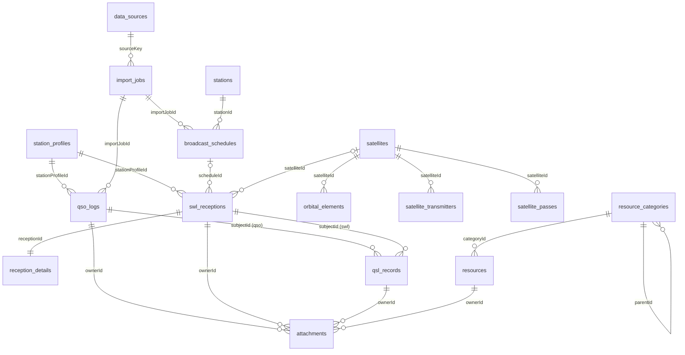
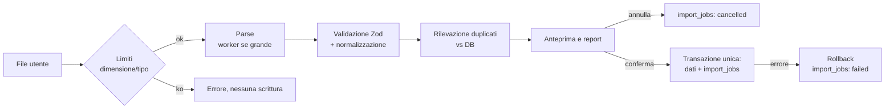

# Modello dati e database — Ham Radio Toolbox v1

| Campo                | Valore                                                                                                                                                                                                                                      |
| -------------------- | ------------------------------------------------------------------------------------------------------------------------------------------------------------------------------------------------------------------------------------------- |
| Stato                | M0 — Progettazione (implementazione in M2)                                                                                                                                                                                                  |
| Ultimo aggiornamento | 2026-10-17                                                                                                                                                                                                                                  |
| Tecnologia           | IndexedDB tramite Dexie.js 4.x, validazione Zod 4.x                                                                                                                                                                                         |
| Documenti collegati  | [Architettura](ARCHITECTURE.md) · [Requisiti](../requirements/REQUIREMENTS.md) · [ADR-0005](../adr/0005-data-conventions.md) · [ADR-0006](../adr/0006-dexie-naming-and-migrations.md) · [ADR-0009](../adr/0009-attachments-in-indexeddb.md) |

Questo documento definisce entità, tabelle, indici, relazioni, migrazioni, flussi di import e formato di backup. È il riferimento per M2; i moduli successivi possono **aggiungere** campi e tabelle solo tramite nuove versioni di schema.

---

## 1. Convenzioni

| Ambito               | Regola                                                                                                                                                                   |
| -------------------- | ------------------------------------------------------------------------------------------------------------------------------------------------------------------------ |
| Nomi tabelle         | `snake_case` plurale (`qso_logs`).                                                                                                                                       |
| Nomi campi           | `camelCase` (`frequencyHz`), identici al tipo TypeScript: nessun mapping fra DB e dominio ([ADR-0006](../adr/0006-dexie-naming-and-migrations.md), da confermare in M2). |
| Chiave primaria      | `id: string` UUID v4 da `crypto.randomUUID()`. Eccezioni: `settings` (chiave stringa `key`).                                                                             |
| Frequenze            | `number` intero in **Hz** (suffisso `Hz`). `Number.isSafeInteger` garantito fino a ~9 PHz.                                                                               |
| Toni sub-audio       | Intero in **decimi di Hz** (suffisso `DeciHz`: 88,5 Hz → `885`). Eccezione motivata in [ADR-0005](../adr/0005-data-conventions.md).                                      |
| Date/ore             | Stringa ISO 8601 UTC con `Z`, precisione al secondo (`2026-10-17T13:21:00Z`). Ordinabile lessicograficamente → indicizzabile.                                            |
| Orari di palinsesto  | Minuti dal 00:00 UTC (`0..1440`).                                                                                                                                        |
| Date senza ora       | `YYYY-MM-DD` (es. validità di un palinsesto).                                                                                                                            |
| Coordinate           | `lat`, `lon` in gradi decimali WGS84 (`lat ∈ [-90, 90]`, `lon ∈ [-180, 180)`).                                                                                           |
| Locator              | Maidenhead normalizzato: campo e quadrato maiuscoli, sottoquadrato minuscolo (`JN45dl`).                                                                                 |
| Nominativi           | Maiuscolo, senza spazi; validazione con Zod (`/^[A-Z0-9]{1,4}(\/[A-Z0-9]{1,8}){0,2}$/`-like, definita in `core/callsign`).                                               |
| Booleani indicizzati | IndexedDB **non** indicizza booleani: se un flag serve come indice si usa `0 \| 1` (es. `isFavorite`). Booleani non indicizzati restano `boolean`.                       |
| Campi opzionali      | Assenti (non `null`) quando non valorizzati; IndexedDB non indicizza `undefined`, comportamento voluto per indici sparsi.                                                |
| Metadati comuni      | Ogni entità utente ha `createdAt` e `updatedAt` (UTC ISO), aggiornati dal repository.                                                                                    |
| Provenienza          | Dati importati: `sourceKey`, `importJobId` e, dove previsto, `raw` (record originale) per tracciabilità e re-parsing.                                                    |
| Dati di esempio      | Campo `isSample: 1` sui record caricati da fixture dimostrative (FR-GEN-04); esclusi da statistiche ed export salvo scelta esplicita.                                    |

Ogni entità ha uno schema Zod in `modules/<modulo>/domain/` (o `core/` se condivisa) e il tipo derivato `z.infer<typeof Schema>`.

---

## 2. Mappa entità → tabelle

| Entità (`PROJECT.md` §7)            | Tabella                  | Modulo proprietario     | Backup                         | Prima versione |
| ----------------------------------- | ------------------------ | ----------------------- | ------------------------------ | -------------- |
| StationProfile                      | `station_profiles`       | settings-backup         | ✅                             | v1 (M2)        |
| QsoLog                              | `qso_logs`               | ham-logbook             | ✅                             | v1             |
| SwlReception                        | `swl_receptions`         | swl-logbook             | ✅                             | v1             |
| ReceptionDetails                    | `reception_details`      | swl-logbook             | ✅                             | v1             |
| QslRecord                           | `qsl_records`            | qsl-manager             | ✅                             | v1             |
| Attachment                          | `attachments`            | shared (infrastructure) | ✅ (opz.)                      | v1             |
| Settings                            | `settings`               | settings-backup         | ✅                             | v1             |
| DataSource                          | `data_sources`           | shared (providers)      | ✅                             | v1             |
| ImportJob                           | `import_jobs`            | shared (infrastructure) | ✅                             | v1             |
| Station                             | `stations`               | frequency-explorer      | ✅                             | v2 (M5)        |
| Frequency                           | `frequencies`            | frequency-explorer      | ✅                             | v2 (M5)        |
| BroadcastSchedule                   | `broadcast_schedules`    | frequency-explorer      | ⚠️ opz. (rigenerabile da file) | v2 (M5)        |
| SignalType                          | `signal_types`           | signal-explorer         | ✅ (solo voci utente)          | v3 (M7)        |
| Satellite                           | `satellites`             | satellite-explorer      | ✅                             | v4 (M8)        |
| OrbitalElements                     | `orbital_elements`       | satellite-explorer      | ⚠️ opz.                        | v4 (M8)        |
| SatelliteTransmitter                | `satellite_transmitters` | satellite-explorer      | ✅                             | v4 (M8)        |
| SatellitePass                       | `satellite_passes`       | satellite-explorer      | ❌ cache derivata              | v4 (M8)        |
| Resource                            | `resources`              | resource-manager        | ✅                             | v5 (M9)        |
| ResourceCategory                    | `resource_categories`    | resource-manager        | ✅                             | v5 (M9)        |
| DxSpot                              | `dx_spots`               | dx-cluster              | ❌ effimero                    | v6 (M10)       |
| Repeater                            | `repeaters`              | repeater-explorer       | ✅                             | v7 (M11)       |
| — (aggiunta M0) AprsBookmark        | `aprs_bookmarks`         | aprs-explorer           | ✅                             | v7 (M11)       |
| — (aggiunta M0) SpaceWeatherReading | `space_weather`          | propagation             | ❌ cache                       | v8 (M12)       |

Le versioni oltre la v1 sono **pianificate**: si materializzano solo nella milestone indicata, ciascuna con la propria migrazione. Le tabelle `aprs_bookmarks` e `space_weather` non compaiono in `PROJECT.md` §7; sono necessarie per FR-APR-02 e FR-PRP-03.

### 2.1 Diagramma delle relazioni



---

## 3. Tabelle — schema v1 (M2)

Notazione: **PK** chiave primaria, **IDX** indicizzato, **opz.** opzionale. I tipi sono quelli TypeScript/Zod.

### `station_profiles`

Profilo della stazione (fissa, portatile, SWL). Un solo profilo predefinito.

| Campo                       | Tipo                                          | Note                                                                                                    |
| --------------------------- | --------------------------------------------- | ------------------------------------------------------------------------------------------------------- |
| `id`                        | uuid                                          | PK                                                                                                      |
| `name`                      | string                                        | Es. "Casa", "Portatile SOTA"                                                                            |
| `kind`                      | `'ham' \| 'swl' \| 'both'`                    | IDX                                                                                                     |
| `callsign`                  | string opz.                                   | IDX; obbligatorio se `kind ≠ 'swl'`                                                                     |
| `swlId`                     | string opz.                                   | Identificativo SWL (es. `I-12345`)                                                                      |
| `operatorName`              | string opz.                                   |                                                                                                         |
| `locator`                   | string opz.                                   | Maidenhead 6 car. consigliato                                                                           |
| `lat`, `lon`                | number opz.                                   | Derivati dal locator se non forniti; fonte indicata in `positionSource: 'locator' \| 'manual' \| 'gps'` |
| `altitudeM`                 | number opz.                                   | Per calcoli satellitari                                                                                 |
| `qth`, `country`            | string opz.                                   |                                                                                                         |
| `dxcc`, `cqZone`, `ituZone` | number opz.                                   |                                                                                                         |
| `equipment`                 | `{ rig?, receiver?, antenna?, powerW? }` opz. | Testo libero                                                                                            |
| `isDefault`                 | `0 \| 1`                                      | IDX; vincolo applicativo: esattamente uno a `1`                                                         |
| `createdAt`, `updatedAt`    | iso                                           |                                                                                                         |

### `qso_logs`

| Campo                    | Tipo                                            | Note                                                             |
| ------------------------ | ----------------------------------------------- | ---------------------------------------------------------------- |
| `id`                     | uuid                                            | PK                                                               |
| `stationProfileId`       | uuid                                            | IDX → `station_profiles`                                         |
| `callsign`               | string                                          | IDX; nominativo del corrispondente                               |
| `datetimeOn`             | iso                                             | IDX; inizio QSO                                                  |
| `datetimeOff`            | iso opz.                                        | ≥ `datetimeOn`                                                   |
| `frequencyHz`            | int                                             | TX                                                               |
| `frequencyRxHz`          | int opz.                                        | Split                                                            |
| `band`                   | string                                          | IDX; derivata (`'20m'`, `'2m'`, `'70cm'`) con valori ADIF `BAND` |
| `mode`                   | string                                          | IDX; enumerazione ADIF `MODE`                                    |
| `submode`                | string opz.                                     | ADIF `SUBMODE` (es. `USB`, `FT4`)                                |
| `rstSent`, `rstRcvd`     | string opz.                                     | Validati in base al modo                                         |
| `txPowerW`               | number opz.                                     |                                                                  |
| `name`, `qth`            | string opz.                                     |                                                                  |
| `gridsquare`             | string opz.                                     | Locator del corrispondente                                       |
| `lat`, `lon`             | number opz.                                     | Derivati da `gridsquare`                                         |
| `country`                | string opz.                                     |                                                                  |
| `dxcc`                   | int opz.                                        | IDX; codice entità ADIF                                          |
| `cqZone`, `ituZone`      | int opz.                                        |                                                                  |
| `continent`              | `'AF'\|'AN'\|'AS'\|'EU'\|'NA'\|'OC'\|'SA'` opz. |                                                                  |
| `potaRef`, `sotaRef`     | string opz.                                     | Riferimento del corrispondente                                   |
| `myPotaRef`, `mySotaRef` | string opz.                                     | Riferimento proprio                                              |
| `contestId`              | string opz.                                     |                                                                  |
| `comment`, `notes`       | string opz.                                     | `comment` ↔ ADIF `COMMENT`, `notes` ↔ ADIF `NOTES`               |
| `adifExtra`              | `Record<string, string>` opz.                   | Campi ADIF non mappati, conservati per l'export                  |
| `origin`                 | `'manual' \| 'adif-import' \| 'restore'`        |                                                                  |
| `importJobId`            | uuid opz.                                       | IDX                                                              |
| `isSample`               | `1` opz.                                        |                                                                  |
| `createdAt`, `updatedAt` | iso                                             |                                                                  |

Indici composti: `[band+mode]`, `[callsign+datetimeOn]` (duplicati e storico per nominativo), `[stationProfileId+datetimeOn]`.

### `swl_receptions`

| Campo                        | Tipo                                                                                                | Note                                                     |
| ---------------------------- | --------------------------------------------------------------------------------------------------- | -------------------------------------------------------- |
| `id`                         | uuid                                                                                                | PK                                                       |
| `stationProfileId`           | uuid                                                                                                | IDX                                                      |
| `category`                   | `'broadcast' \| 'amateur' \| 'utility' \| 'digital' \| 'aeronautical' \| 'maritime' \| 'satellite'` | IDX                                                      |
| `datetimeStart`              | iso                                                                                                 | IDX                                                      |
| `datetimeEnd`                | iso opz.                                                                                            |                                                          |
| `frequencyHz`                | int                                                                                                 | IDX                                                      |
| `band`                       | string opz.                                                                                         | Derivata (bande metriche broadcast o radioamatoriali)    |
| `modulation`                 | string                                                                                              | `AM`, `USB`, `LSB`, `CW`, `FM`, `DRM`, `NFM`, `DIGITAL`… |
| `stationName`                | string                                                                                              | IDX; nome/identificativo della stazione ascoltata        |
| `stationId`                  | uuid opz.                                                                                           | → `stations`                                             |
| `country`                    | string opz.                                                                                         | IDX; codice ITU/ISO dichiarato                           |
| `language`                   | string opz.                                                                                         | IDX                                                      |
| `sinpo`                      | string opz.                                                                                         | 5 cifre `1-5`, es. `45444`                               |
| `rst`                        | string opz.                                                                                         |                                                          |
| `receiverLocator`            | string opz.                                                                                         | Se diverso dal profilo (portatile)                       |
| `receiverLat`, `receiverLon` | number opz.                                                                                         |                                                          |
| `equipment`                  | `{ receiver?, antenna?, software? }` opz.                                                           |                                                          |
| `notes`                      | string opz.                                                                                         |                                                          |
| `scheduleId`                 | uuid opz.                                                                                           | → `broadcast_schedules` (FR-SWL-09)                      |
| `satelliteId`                | uuid opz.                                                                                           | → `satellites`                                           |
| `isSample`                   | `1` opz.                                                                                            |                                                          |
| `createdAt`, `updatedAt`     | iso                                                                                                 |                                                          |

Indici composti: `[category+datetimeStart]`.

### `reception_details`

Dati specifici per categoria, relazione 1:1 con `swl_receptions`. Schema Zod **discriminato** su `category`.

| Campo                    | Tipo               | Note                             |
| ------------------------ | ------------------ | -------------------------------- |
| `id`                     | uuid               | PK                               |
| `receptionId`            | uuid               | IDX univoco (`&receptionId`)     |
| `category`               | come sopra         | Deve coincidere con la ricezione |
| `data`                   | union discriminata | Vedi tabella                     |
| `createdAt`, `updatedAt` | iso                |                                  |

| Categoria      | Campi di `data` (tutti opzionali salvo indicazione)                                                                                                                                           |
| -------------- | --------------------------------------------------------------------------------------------------------------------------------------------------------------------------------------------- |
| `broadcast`    | `programme`, `targetArea`, `transmitterSite`, `powerKw`, `scheduleSource` (`'eibi' \| 'hfcc' \| 'manual'`), `qslRequested: boolean`                                                           |
| `amateur`      | `callsignHeard` (obbl.), `workingCallsign`, `amateurMode`, `heardLocator`                                                                                                                     |
| `utility`      | `serviceType` (`'time-signal' \| 'beacon' \| 'weather' \| 'navtex' \| 'military' \| 'other'`), `identifier`, `scheduleNote`                                                                   |
| `digital`      | `digitalMode` (obbl., es. `RTTY`, `PSK31`, `FT8`, `DRM`, `HFDL`, `STANAG 4285`), `baudRate`, `shiftHz`, `decoderSoftware`, `decoded: boolean`                                                 |
| `aeronautical` | `service` (`'volmet' \| 'hf-atc' \| 'hfdl' \| 'acars' \| 'other'`), `groundStation`, `region` — **nessun campo per il contenuto dei messaggi** (FR-SWL-04)                                    |
| `maritime`     | `service` (`'coast-station' \| 'navtex' \| 'dsc' \| 'weather' \| 'other'`), `coastStation`, `navtexId` — **nessun campo per il contenuto dei messaggi** né per identificativi di navi private |
| `satellite`    | `satelliteName` (obbl.), `noradId`, `downlinkMode`, `aos`, `los`, `maxElevationDeg`                                                                                                           |

### `qsl_records`

Unica fonte di verità sugli stati QSL (D-12 in [Architettura](ARCHITECTURE.md#132-divergenze-e-lacune-da-risolvere-nella-milestone-indicata)).

| Campo                                                | Tipo                                                              | Note                            |
| ---------------------------------------------------- | ----------------------------------------------------------------- | ------------------------------- |
| `id`                                                 | uuid                                                              | PK                              |
| `subjectType`                                        | `'qso' \| 'swl'`                                                  |                                 |
| `subjectId`                                          | uuid                                                              | → `qso_logs` o `swl_receptions` |
| `channel`                                            | `'paper' \| 'eqsl' \| 'lotw' \| 'qrz' \| 'clublog' \| 'other'`    | IDX                             |
| `via`                                                | `'bureau' \| 'direct' \| 'manager' \| 'electronic'` opz.          |                                 |
| `managerCallsign`                                    | string opz.                                                       |                                 |
| `status`                                             | `'pending' \| 'requested' \| 'sent' \| 'received' \| 'confirmed'` | IDX; stato corrente             |
| `requestedAt`, `sentAt`, `receivedAt`, `confirmedAt` | iso opz.                                                          | Data di ogni transizione        |
| `notes`                                              | string opz.                                                       |                                 |
| `origin`                                             | `'manual' \| 'adif-import'`                                       |                                 |
| `importJobId`                                        | uuid opz.                                                         |                                 |
| `createdAt`, `updatedAt`                             | iso                                                               |                                 |

Indici: `[subjectType+subjectId]`, `[channel+status]`. Vincolo applicativo: al più un record per `(subjectType, subjectId, channel)`.

Mapping ADIF (M3): `QSL_SENT/QSL_RCVD/QSLSDATE/QSLRDATE/QSL_VIA` → canale `paper`; `LOTW_QSL_SENT/LOTW_QSL_RCVD/LOTW_QSLSDATE/LOTW_QSLRDATE` → `lotw`; `EQSL_QSL_*` → `eqsl`; `QRZCOM_QSO_UPLOAD_*`/`QRZCOM_QSO_DOWNLOAD_*` → `qrz`. Valori ADIF `Y/N/R/Q/I` mappati sugli stati (tabella dettagliata in M3).

### `attachments`

| Campo       | Tipo                                              | Note                                                                                 |
| ----------- | ------------------------------------------------- | ------------------------------------------------------------------------------------ |
| `id`        | uuid                                              | PK                                                                                   |
| `ownerType` | `'qso' \| 'swl_reception' \| 'qsl' \| 'resource'` |                                                                                      |
| `ownerId`   | uuid                                              |                                                                                      |
| `fileName`  | string                                            | Sanitizzato                                                                          |
| `mimeType`  | string                                            | Lista ammessa: immagini, audio, PDF, testo                                           |
| `sizeBytes` | int                                               | ≤ limite configurato (default 20 MB)                                                 |
| `sha256`    | string                                            | IDX; deduplicazione                                                                  |
| `blob`      | Blob                                              | Contenuto binario in IndexedDB ([ADR-0009](../adr/0009-attachments-in-indexeddb.md)) |
| `createdAt` | iso                                               |                                                                                      |

Indice composto: `[ownerType+ownerId]`. Le query di elenco **non** devono caricare `blob` inutilmente: i repository espongono metadati e contenuto con metodi distinti.

### `settings`

Chiave-valore per preferenze applicative.

| Campo       | Tipo                                         | Note                                    |
| ----------- | -------------------------------------------- | --------------------------------------- |
| `key`       | string                                       | PK (`'app'`, `'dashboard'`, `'units'`…) |
| `value`     | JSON validato con lo schema Zod della chiave |                                         |
| `updatedAt` | iso                                          |                                         |

### `data_sources`

Registro delle fonti esterne e del loro stato locale (FR-SET-08, FR-DSH-05).

| Campo                | Tipo                                    | Note                                                                                                                 |
| -------------------- | --------------------------------------- | -------------------------------------------------------------------------------------------------------------------- |
| `key`                | string                                  | PK stabile (`'eibi'`, `'hfcc'`, `'celestrak'`, `'satnogs'`, …) — eccezione all'UUID: è un identificatore di catalogo |
| `accessMode`         | `'native' \| 'manual-import' \| 'link'` | Dichiarato nel codice, copiato qui per diagnostica                                                                   |
| `lastAttemptAt`      | iso opz.                                |                                                                                                                      |
| `lastSuccessAt`      | iso opz.                                |                                                                                                                      |
| `lastError`          | string opz.                             |                                                                                                                      |
| `datasetVersion`     | string opz.                             | Es. stagione `A26`, epoca più recente                                                                                |
| `nextAllowedFetchAt` | iso opz.                                | Rispetto del rate limit                                                                                              |

I metadati statici (nome, licenza, URL) restano nel `ProviderDescriptor` nel codice; la tabella contiene solo lo stato.

### `import_jobs`

| Campo                     | Tipo                                                                                           | Note                                      |
| ------------------------- | ---------------------------------------------------------------------------------------------- | ----------------------------------------- |
| `id`                      | uuid                                                                                           | PK                                        |
| `kind`                    | `'adif' \| 'eibi' \| 'hfcc' \| 'tle' \| 'omm' \| 'satnogs' \| 'raindrop' \| 'csv' \| 'backup'` | IDX                                       |
| `sourceKey`               | string opz.                                                                                    | → `data_sources.key`                      |
| `fileName`                | string opz.                                                                                    |                                           |
| `fileSha256`              | string opz.                                                                                    | Rileva il re-import dello stesso file     |
| `datasetVersion`          | string opz.                                                                                    |                                           |
| `status`                  | `'committed' \| 'failed' \| 'cancelled'`                                                       | IDX                                       |
| `startedAt`, `finishedAt` | iso                                                                                            | IDX su `startedAt`                        |
| `counts`                  | `{ total, valid, invalid, duplicates, inserted, updated, skipped }`                            |                                           |
| `errors`                  | `Array<{ location: string, field?: string, code: string, message: string }>`                   | Max 500 voci, poi `errorsTruncated: true` |
| `options`                 | object opz.                                                                                    | Politica duplicati ecc.                   |

Il job viene scritto **nella stessa transazione** del commit (o da solo in caso di fallimento/annullamento). L'anteprima non produce scritture.

---

## 4. Tabelle pianificate (M5–M12)

Descritte qui per validare il modello complessivo; dettagli e indici definitivi si fissano nella milestone, con nuova versione di schema.

### `stations` (v2, M5)

`id`, `name` (IDX), `kind` (`'broadcast' \| 'utility' \| 'other'`), `country` (IDX, codice ITU), `callsign?`, `homepage?`, `notes?`, `sourceKey?`, `createdAt`, `updatedAt`. Popolata dagli import (deduplicata per `name+country`) o a mano.

### `frequencies` (v2, M5)

Memorie/catalogo personale: `id`, `frequencyHz` (IDX), `bandwidthHz?`, `mode`, `service?`, `label`, `stationId?`, `tags: string[]` (IDX multiEntry `*tags`), `notes?`, `sourceKey?`, `createdAt`, `updatedAt`.

### `broadcast_schedules` (v2, M5)

| Campo                      | Tipo               | Note                                                                                                                                                                               |
| -------------------------- | ------------------ | ---------------------------------------------------------------------------------------------------------------------------------------------------------------------------------- |
| `id`                       | uuid               | PK                                                                                                                                                                                 |
| `importJobId`              | uuid               | IDX; identifica il dataset                                                                                                                                                         |
| `sourceKey`                | `'eibi' \| 'hfcc'` |                                                                                                                                                                                    |
| `season`                   | string             | IDX; `A26`, `B26`                                                                                                                                                                  |
| `frequencyHz`              | int                | IDX (EiBi è in kHz con decimali e HFCC in kHz interi → ×1000, con arrotondamento)                                                                                                  |
| `startMinute`, `endMinute` | int `0..1440`      | Fasce a cavallo di mezzanotte: `endMinute < startMinute`                                                                                                                           |
| `days`                     | int bitmask opz.   | Lun=1 … Dom=64; assente = tutti i giorni                                                                                                                                           |
| `validFrom`, `validTo`     | date opz.          | Colonne Start/Stop di EiBi, `FDATE`/`TDATE` di HFCC (`DDMMYY`)                                                                                                                     |
| `stationName`              | string             | IDX                                                                                                                                                                                |
| `stationId`                | uuid opz.          |                                                                                                                                                                                    |
| `itu`                      | string opz.        | IDX; paese ITU                                                                                                                                                                     |
| `language`                 | string opz.        | IDX                                                                                                                                                                                |
| `targetArea`               | string opz.        | EiBi `Target`; HFCC zone CIRAF (es. `4,9,27,37-39`)                                                                                                                                |
| `transmitterSite`          | string opz.        | EiBi colonna sito; HFCC `LOC` (codice da `site.txt`)                                                                                                                               |
| `powerKw`, `azimuthDeg`    | number opz.        | HFCC `POWR`, `AZIMUTH`                                                                                                                                                             |
| `hfcc`                     | object opz.        | Solo HFCC: `{ adm, broadcaster, fmo, modulation, antennaCode, slew, requestId }` (colonne `ADM`, `BRC`, `FMO`, `MOD`, `ANT`, `SLW`, `REQ#`); mappatura definitiva dopo HFCC-DEP-01 |
| `remarks`                  | string opz.        |                                                                                                                                                                                    |
| `raw`                      | string             | Riga originale                                                                                                                                                                     |

Indici composti: `[season+frequencyHz]`. La query "in onda ora" filtra per frequenza/indice e poi in memoria per minuto/giorno (A26: 9 593 righe EiBi, 3 388 record HFCC: entro NFR-PERF-05).

### `signal_types` (v3, M7)

`id`, `name` (IDX), `aliases: string[]` (IDX `*aliases`), `category` (IDX), `modulation`, `bandwidthHz?: { min?, max? }`, `frequencyRanges: Array<{ minHz, maxHz }>`, `description` (testo redatto in proprio), `externalUrl?`, `media?: Array<{ url, kind, license }>`, `origin: 'bundled' \| 'user'`, `createdAt`, `updatedAt`. Le voci `bundled` provengono da un JSON versionato nel repository e vengono sincronizzate da migrazione/seed; non entrano nel backup.

### `satellites` (v4, M8)

`id`, `noradId` (IDX univoco `&noradId`), `name` (IDX), `alternateNames: string[]`, `satnogsId?`, `status: 'alive' \| 'dead' \| 'reentered' \| 'unknown'` (IDX), `statusSource?`, `notes?`, `createdAt`, `updatedAt`.

### `orbital_elements` (v4, M8)

`id`, `satelliteId` (IDX), `noradId` (IDX), `epoch` (iso, IDX), `format: 'tle' \| 'omm'`, `tleLine1?`, `tleLine2?`, `omm?` (oggetto OMM validato), `sourceKey`, `importJobId?`, `fetchedAt`. Si conserva l'ultimo set per satellite (più eventualmente il precedente); i vecchi vengono eliminati nella stessa transazione.

### `satellite_transmitters` (v4, M8)

`id`, `satelliteId` (IDX), `noradId` (IDX), `externalUuid` (UUID SatNOGS, IDX univoco), `description`, `type`, `uplinkLowHz?`, `uplinkHighHz?`, `downlinkLowHz?`, `downlinkHighHz?`, `mode?`, `uplinkMode?`, `baud?`, `invert`, `status: 'active' \| 'inactive' \| 'invalid'`, `alive: boolean`, `sourceUpdatedAt?`, `importJobId`, `raw`.

### `satellite_passes` (v4, M8) — cache derivata

`id`, `satelliteId` (IDX), `stationProfileId`, `elementsId`, `aos` (IDX), `tca`, `los`, `maxElevationDeg`, `aosAzimuthDeg`, `losAzimuthDeg`, `computedAt`. Invalidata quando cambiano elementi o profilo; mai inclusa nel backup.

### `resource_categories` (v5, M9)

`id`, `name`, `parentId?` (IDX), `path` (IDX, es. `Hobbies/Ham Radio`), `sortOrder`, `origin: 'raindrop' \| 'user'`, `createdAt`, `updatedAt`.

### `resources` (v5, M9)

`id`, `url`, `normalizedUrl` (IDX, duplicati), `title` (IDX), `description?`, `categoryId?` (IDX), `tags: string[]` (IDX `*tags`), `isFavorite: 0 \| 1` (IDX), `addedAt?` (da `ADD_DATE`, epoch → ISO), `sourceModifiedAt?` (`LAST_MODIFIED`), `coverUrl?` (non caricata automaticamente), `origin: 'raindrop' \| 'user'`, `importJobId?`, `createdAt`, `updatedAt`.

### `dx_spots` (v6, M10) — effimera

`id`, `externalId?` (IDX univoco per fonte: `[sourceKey+externalId]`), `sourceKey`, `dxCallsign` (IDX), `spotterCallsign`, `frequencyHz` (IDX), `band` (IDX), `mode?`, `comment?`, `spottedAt` (IDX), `fetchedAt`, `dxCountry?`. Pulizia automatica dei record con `fetchedAt` > 24 h.

### `repeaters` (v7, M11)

`id`, `callsign` (IDX), `name?`, `outputHz` (IDX), `inputHz?`, `offsetHz?` (derivato, con segno), `mode` (IDX: `'FM' \| 'DMR' \| 'DSTAR' \| 'C4FM' \| 'NXDN' \| 'TETRA' \| 'P25' \| 'MULTI' \| 'OTHER'`), `ctcssTxDeciHz?`, `ctcssRxDeciHz?`, `dcsCode?`, `dmrColorCode?`, `dmrTalkgroups?`, `lat?`, `lon?`, `locator?` (IDX), `qth?`, `region?`, `country?`, `status: 'active' \| 'inactive' \| 'unknown'`, `origin: 'user' \| 'csv-import'`, `sourceNote?`, `notes?`, `createdAt`, `updatedAt`. La ricerca per distanza calcola in memoria (cataloghi personali: centinaia/migliaia di voci).

### `aprs_bookmarks` (v7, M11)

`id`, `callsign` (IDX), `ssid?`, `label?`, `notes?`, `createdAt`, `updatedAt`.

### `space_weather` (v8, M12) — cache

`id`, `sourceKey`, `metric` (`'sfi' \| 'kp' \| 'a' \| 'xray' \| 'solarWindSpeed' \| …`), `kind: 'observed' \| 'forecast'`, `timeTag` (iso, IDX), `value`, `unit`, `fetchedAt`. Indice composto `[metric+timeTag]`. Conservazione: 30 giorni.

---

## 5. Definizione Dexie (riferimento per M2)

Schema della **versione 1** come verrà scritto in `src/infrastructure/db/schema.ts` (illustrativo; la forma definitiva si fissa in M2 con i test):

```ts
db.version(1).stores({
  station_profiles: "id, kind, callsign, isDefault",
  qso_logs:
    "id, stationProfileId, callsign, datetimeOn, band, mode, dxcc, importJobId, " +
    "[band+mode], [callsign+datetimeOn], [stationProfileId+datetimeOn]",
  swl_receptions:
    "id, stationProfileId, category, datetimeStart, frequencyHz, stationName, country, language, " +
    "[category+datetimeStart]",
  reception_details: "id, &receptionId",
  qsl_records: "id, channel, status, [subjectType+subjectId], [channel+status]",
  attachments: "id, sha256, [ownerType+ownerId]",
  settings: "key",
  data_sources: "key",
  import_jobs: "id, kind, status, startedAt",
});
```

Solo i campi indicizzati compaiono nella stringa; gli altri sono memorizzati ma non dichiarati (comportamento standard Dexie).

---

## 6. Integrità referenziale (applicativa)

IndexedDB non ha chiavi esterne: l'integrità è garantita dai repository e coperta da test di integrazione.

| Operazione                                         | Regola                                                                                                                                                              |
| -------------------------------------------------- | ------------------------------------------------------------------------------------------------------------------------------------------------------------------- |
| Elimina `qso_logs`                                 | Cascata su `qsl_records` (`subjectType='qso'`) e `attachments` (`ownerType='qso'`), stessa transazione.                                                             |
| Elimina `swl_receptions`                           | Cascata su `reception_details`, `qsl_records` (`swl`), `attachments`.                                                                                               |
| Elimina `qsl_records`                              | Cascata su `attachments` (`qsl`).                                                                                                                                   |
| Elimina `station_profiles`                         | **Bloccata** se referenziato da QSO/ricezioni (proposta di riassegnazione). Non si può eliminare l'ultimo profilo.                                                  |
| Elimina dataset (`import_jobs` di tipo palinsesto) | Cascata su `broadcast_schedules`; i riferimenti `swl_receptions.scheduleId` restano ma diventano "orfani tollerati" (la ricezione conserva i propri dati testuali). |
| Elimina `satellites`                               | Cascata su `orbital_elements`, `satellite_transmitters`, `satellite_passes`; `swl_receptions.satelliteId` → orfano tollerato.                                       |
| Elimina `resource_categories`                      | Figli e risorse spostati nella categoria padre (o radice).                                                                                                          |
| Verifica orfani                                    | Funzione diagnostica in Impostazioni (FR-SET-04) che segnala e, su conferma, ripulisce gli orfani non tollerati.                                                    |

---

## 7. Migrazioni

- Ogni modifica di schema = `db.version(n + 1).stores({...}).upgrade(tx => …)`; le versioni precedenti restano nel codice invariate ([ADR-0006](../adr/0006-dexie-naming-and-migrations.md)).
- Le migrazioni di dati sono funzioni pure `migrateVnToVn1(record)` riutilizzate anche dal **restore** di backup vecchi.
- Test obbligatori per ogni migrazione: database popolato alla versione `n` con `fake-indexeddb` → apertura alla `n+1` → verifica di dati e indici.
- Registro migrazioni in questo documento (sezione da aggiungere in M2: _Storico versioni_).
- Gestione `versionchange`/`blocked`: se un'altra scheda tiene aperto il DB vecchio, l'app chiude la connessione e chiede il ricaricamento.

---

## 8. Flusso di import (comune a tutti i formati)



| Formato       | Limite file (proposta)    | Parser                                                                                                                                                                                                                   |
| ------------- | ------------------------- | ------------------------------------------------------------------------------------------------------------------------------------------------------------------------------------------------------------------------ |
| ADIF `.adi`   | 50 MB                     | Tokenizzatore `<FIELD:len[:type]>` con gestione `<EOH>`/`<EOR>`, lunghezza in byte UTF-8                                                                                                                                 |
| EiBi CSV      | 10 MB                     | CSV `;`, prima riga header, codifica da verificare (Latin-1 vs UTF-8) in M5                                                                                                                                              |
| HFCC `allx2`  | 20 MB (ZIP) / 50 MB (TXT) | Larghezza fissa con riga-righello; ZIP _deflate_ (verificato) decompresso con `DecompressionStream('deflate-raw')` + directory centrale, oppure dipendenza leggera con ADR ([ADR-0012](../adr/0012-hfcc-in-v1-scope.md)) |
| TLE / OMM     | 10 MB                     | Checksum TLE verificato; OMM JSON validato con Zod                                                                                                                                                                       |
| SatNOGS JSON  | 20 MB                     | Validazione Zod dei campi usati                                                                                                                                                                                          |
| Raindrop HTML | 10 MB                     | `DOMParser`                                                                                                                                                                                                              |
| CSV generico  | 10 MB                     | Parser CSV con mapping colonne                                                                                                                                                                                           |
| Backup JSON   | 500 MB                    | Validazione per tabella                                                                                                                                                                                                  |

---

## 9. Backup e restore

### 9.1 Formato

```jsonc
{
  "format": "ham-radio-toolbox-backup",
  "schemaVersion": 1, // versione dello schema Dexie al momento dell'export
  "backupFormatVersion": 1, // versione del contenitore
  "appVersion": "0.3.0",
  "exportedAt": "2026-10-17T13:21:00Z",
  "includesAttachments": true,
  "tables": {
    "station_profiles": [/* record */],
    "qso_logs": [/* … */],
    "attachments": [{ "id": "…", "mimeType": "audio/ogg", "dataBase64": "…" }],
  },
  "counts": { "qso_logs": 1234 },
}
```

- Tabelle incluse: quelle marcate ✅ nella [§ 2](#2-mappa-entità--tabelle); `broadcast_schedules` e `orbital_elements` opzionali (rigenerabili); cache escluse.
- Allegati: inclusi come base64 solo se scelto dall'utente (aumentano il file di ~33 %). Per backup molto grandi si valuterà in M13 un contenitore ZIP (decisione con ADR).
- Il file è scaricato con nome `hrt-backup-YYYYMMDD-HHMMZ.json`.

### 9.2 Restore

1. Validazione dell'involucro (`format`, versioni).
2. `schemaVersion > corrente` → rifiuto ("aggiorna l'app").
3. `schemaVersion < corrente` → applicazione in memoria delle funzioni di migrazione `vN → vN+1` in sequenza.
4. Validazione Zod di ogni record; errori riportati per tabella/id.
5. Anteprima conteggi; modalità **sostituisci** (svuota le tabelle utente) o **unisci** (upsert per `id`, il record con `updatedAt` più recente vince).
6. Commit in un'unica transazione su tutte le tabelle coinvolte; registrazione in `import_jobs` (`kind: 'backup'`).

Test obbligatori: round-trip identico; restore di un backup v1 dopo ogni nuova versione di schema (fixture conservate in `tests/fixtures/backup/`).

---

## 10. Quota e persistenza

- `navigator.storage.persist()` richiesto al primo avvio utile; esito mostrato in Impostazioni (FR-SET-03).
- `navigator.storage.estimate()` per mostrare uso e quota; avviso oltre l'80 %.
- In caso di `QuotaExceededError` la transazione fallisce senza dati parziali; l'utente viene invitato a liberare spazio (cache, allegati, dataset).
