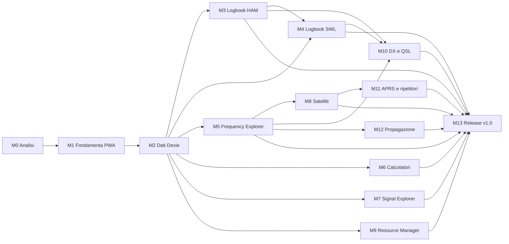

# Roadmap e backlog — Ham Radio Toolbox v1

| Campo                | Valore                                                                                                                                                                              |
| -------------------- | ----------------------------------------------------------------------------------------------------------------------------------------------------------------------------------- |
| Stato                | M0 — Approvato dal maintainer (2026-10-17)                                                                                                                                          |
| Ultimo aggiornamento | 2026-10-17                                                                                                                                                                          |
| Capacità             | 10–12 h/settimana (nominale 11 h)                                                                                                                                                   |
| Stima M1–M13         | 171 h di base + 40 h di riserva (23,4 %) = **211 h** ≈ **19–23 settimane** dopo M0 (nominale: 21 settimane in totale, M0 inclusa)                                                   |
| Documenti collegati  | [Requisiti](../requirements/REQUIREMENTS.md) · [Architettura](../architecture/ARCHITECTURE.md) · [Database](../architecture/DATABASE.md) · [Fonti dati](../data-sources/SOURCES.md) |

La pianificazione è provvisoria (PROJECT §10) e va raffinata all'inizio di ogni milestone stimando i task del backlog. Le stime di questa versione derivano dalla **somma dei task del backlog** (§ 4) più una **riserva esplicita** (§ 2.2). Il perimetro funzionale non cambia rispetto alla prima stesura di M0. L'unica variazione di priorità è HFCC, passato a _Must_ per [ADR-0012](../adr/0012-hfcc-in-v1-scope.md).

---

## 1. Dipendenze fra milestone

### 1.1 Motivazione delle dipendenze

| Dipendenza        | Motivo                                                                                                                                                                                                                                    |
| ----------------- | ----------------------------------------------------------------------------------------------------------------------------------------------------------------------------------------------------------------------------------------- |
| M1 → M2 → tutti   | Layer dati, repository, import pipeline e `core/*` (frequenza, locator, tempo) sono usati da ogni modulo.                                                                                                                                 |
| M3 → M4           | Componenti condivisi (input frequenza/ora UTC, allegati, pattern import/export).                                                                                                                                                          |
| M5 → M8, M10, M12 | M5 introduce il contratto `ProviderDescriptor`, il registry delle fonti e il pannello freschezza (BL-M5-04), riusati da CelesTrak (M8), DX Summit se approvato (M10) e NOAA SWPC/HamQSL (M12). _Dipendenza aggiunta alla chiusura di M0._ |
| M3, M4 → M10      | Le QSL si collegano a QSO e ricezioni SWL; FR-SWL-10 genera il rapporto di ricezione.                                                                                                                                                     |
| M8 → M11          | Integrazione Leaflet/OSM introdotta in M8.                                                                                                                                                                                                |
| M2 → M6           | Il domain di locator e unità (`core/locator`, `core/units`) è in M2 (D-11); M6 realizza solo le interfacce.                                                                                                                               |
| tutte → M13       | Test di sistema, backup completo, audit e release.                                                                                                                                                                                        |

**Verifica di coerenza** (eseguita alla chiusura di M0):

- tutte le dipendenze puntano da una milestone a una di numero maggiore, quindi l'ordine M0 → M13 di `CLAUDE.md` è un ordinamento topologico valido;
- nessun requisito è assegnato a una milestone precedente a quella che fornisce ciò di cui ha bisogno. I requisiti divisi su più milestone sono intenzionali: FR-SWL-09 (M5/M8), FR-HAM-11 (M3/M10), FR-DSH-05 (M5→M12), FR-RFC-09/10 (domain M2, UI M6).

### 1.2 Cammino critico

Lavoro di un solo sviluppatore con milestone in sequenza: la durata totale è la somma delle milestone. Il cammino critico serve quindi a individuare **dove un ritardo propaga**, non a parallelizzare.

| Catena dopo M2          | Ore di base           | Ore con riserva assegnata |
| ----------------------- | --------------------- | ------------------------- |
| **A**: M3 → M4 → M10    | 22 + 12 + 12 = **46** | 28 + 14 + 15 = 57         |
| **B**: M5 → M8 → M11    | 18 + 18 + 10 = **46** | 24 + 24 + 12 = **60**     |
| M5 → M12                | 24                    | 31                        |
| M6, M7, M9 (solo da M2) | 10 / 6 / 10           | 11 / 6 / 11               |

- Le catene **A e B sono entrambe critiche** con le stime di base (46 h ciascuna; con M0, M1, M2 e M13: 105 h). Considerando la riserva, B è la più lunga, perché contiene i rischi HFCC (M5) e SGP4 (M8).
- Il cammino critico del documento precedente (M1 → M2 → M3 → M4 → M10 → M13) resta valido, ma non è l'unico.
- M6, M7 e M9 hanno margine: non bloccano altre milestone. Spostarle nell'ordine resta comunque una deroga a `CLAUDE.md` e richiede l'approvazione del maintainer.
- **Rischio esterno su B**: la risposta sui termini HFCC (HFCC-DEP-02) può richiedere tempo. La richiesta va inviata **in anticipo**, durante M1–M4 (vedi BL-M5-07), così da non fermare M5.

---

## 2. Stime, riserva e calendario

### 2.1 Calendario indicativo (11 h/settimana)

| Milestone                         | Base (h) | Riserva (h) | Totale (h) | Settimane | Settimane di calendario |
| --------------------------------- | -------- | ----------- | ---------- | --------- | ----------------------- |
| M0 Analisi e progettazione        | 12       | —           | 12         | 1,1       | 1                       |
| M1 Fondamenta PWA e dashboard     | 13       | 2           | 15         | 1,4       | 2–3                     |
| M2 Persistenza e core domain      | 16       | 4           | 20         | 1,8       | 3–5                     |
| M3 HAM Logbook + ADIF             | 22       | 6           | 28         | 2,5       | 5–7                     |
| M4 SWL Logbook                    | 12       | 2           | 14         | 1,3       | 7–8                     |
| M5 Frequency Explorer + EiBi/HFCC | 18       | 6           | 24         | 2,2       | 9–11                    |
| M6 Calcolatori RF e locator       | 10       | 1           | 11         | 1,0       | 11–12                   |
| M7 Signal Explorer                | 6        | 0           | 6          | 0,5       | 12                      |
| M8 Satellite Explorer             | 18       | 6           | 24         | 2,2       | 12–14                   |
| M9 Resource Manager + Raindrop    | 10       | 1           | 11         | 1,0       | 14–15                   |
| M10 DX Cluster e QSL              | 12       | 3           | 15         | 1,4       | 15–17                   |
| M11 APRS e ripetitori             | 10       | 2           | 12         | 1,1       | 17–18                   |
| M12 Propagazione                  | 6        | 1           | 7          | 0,6       | 18                      |
| M13 Test, sicurezza, release v1.0 | 18       | 6           | 24         | 2,2       | 19–21                   |
| **Totale M1–M13**                 | **171**  | **40**      | **211**    | **19,2**  | **2–21**                |

- Le ore di base sono la somma dei task di § 4, senza arrotondamenti a forfait. Rispetto alla prima stesura (178 h, M0 inclusa), la base cresce di 5 h: M5 +2 h per la verifica HFCC (BL-M5-07), M1 +1 h per l'allineamento al backlog, M0 +2 h per la chiusura formale e la sua consuntivazione.
- Le settimane di calendario si sovrappongono quando una milestone finisce e la successiva inizia nella stessa settimana.
- Sensibilità: a 12 h/settimana servono 17,6 settimane dopo M0 (19 in totale); a 10 h/settimana 21,1 (23 in totale). Senza riserva, a 11 h, 15,5 settimane (17 in totale).
- **Scostamento da `PROJECT.md` §10** (16 settimane): già la sola base (171 h) supera le 16 settimane a 11 h/settimana. `PROJECT.md` dichiara il calendario provvisorio. Questo documento è il riferimento aggiornato, e `PROJECT.md` va allineato quando lo decide il maintainer (D-20).

### 2.2 Regole della riserva

1. **Entità**: 40 h, pari al 23,4 % della base M1–M13 (intervallo approvato: 20–25 %).
2. **Assegnazione indicativa per rischio**:
   - 6 h ciascuna a M3 (ADIF), M5 (HFCC), M8 (SGP4) e M13 (test di sistema);
   - 4 h a M2 (migrazioni);
   - 3 h a M10;
   - 2 h ciascuna a M1, M4 e M11;
   - 1 h ciascuna a M6, M9 e M12.
3. **Gestione a pool**: la riserva non consumata da una milestone torna disponibile per le successive. Non è un "tempo libero" da pianificare in anticipo.
4. **Nessun aumento di perimetro**: la riserva copre stime errate e rischi, non nuove funzionalità.
   - Tagliare requisiti _Should/Could_ richiede una nota nel backlog.
   - Tagliare requisiti _Must_ richiede un ADR e l'approvazione del maintainer.
5. **Soglia di ripianificazione**: se prima dell'inizio di M8 è stato consumato più del 50 % della riserva (> 20 h), si ripianifica con il maintainer.
6. **Consuntivo**: alla chiusura di ogni milestone si registrano ore effettive e riserva usata in § 2.3.

### 2.3 Consuntivo

| Milestone | Stima (h) | Effettivo (h)       | Riserva usata (h) | Riserva residua (h) | Note                        |
| --------- | --------- | ------------------- | ----------------- | ------------------- | --------------------------- |
| M0        | 12        | n/d (non tracciato) | —                 | 40                  | Ore effettive non misurate. |

---

## 3. Milestone

Ogni milestone richiede (PROJECT §10): perimetro documentato, task, criteri di accettazione, test automatici pertinenti, documentazione aggiornata, build di produzione riuscita. Criterio comune a tutte da M1 in poi: **`typecheck`, `lint`, `test` e `build` verdi in CI**.

### M0 — Analisi e progettazione ✅ (approvata, chiusura formale 2026-10-17)

- **Obiettivo**: requisiti, architettura, ADR, modello dati, casi d'uso, fonti dati, backlog.
- **Deliverable**:
  - `docs/requirements/REQUIREMENTS.md`, `docs/architecture/ARCHITECTURE.md`, `docs/architecture/DATABASE.md`;
  - `docs/data-sources/SOURCES.md`, `docs/roadmap/ROADMAP.md`;
  - `docs/adr/0001…0012`, README, aggiornamento di `CLAUDE.md`.
- **Criteri di accettazione**: vedi [§ 5 Checklist M0](#5-checklist-di-completamento-m0).

### M1 — Fondamenta PWA e dashboard

- **Dipende da**: M0 approvata e committata.
- **Obiettivo**: app shell installabile e offline, struttura cartelle, qualità, CI e deploy su Cloudflare Pages.
- **Requisiti**: FR-GEN-01, FR-GEN-07, FR-DSH-01..04, 06, 08, NFR-OFF-02, NFR-MNT-01/02/04, NFR-I18N-01, CON-13.
- **Criteri di accettazione**:
  - `npm run dev|build|preview|typecheck|lint|format|test|test:e2e` funzionanti come in `CLAUDE.md`.
  - Lighthouse: PWA installabile; manifest e icone validi.
  - Con rete disattivata (Playwright `setOffline`) l'app si apre e tutte le route dei 14 moduli sono navigabili.
  - Toast di aggiornamento funzionante (test manuale con due build).
  - Regole ESLint di layer attive e verificate da un test negativo.
  - Nessuna stringa UI hardcoded: catalogo i18n tipizzato ([ADR-0008](../adr/0008-i18n-approach.md)) e controllo in lint o CI.
  - Deploy su Cloudflare Pages da GitHub Actions ([ADR-0011](../adr/0011-static-hosting-and-routing.md)), con questi controlli:
    - accesso diretto a una route profonda (es. `/ham-logbook`) senza service worker: risposta 200 con l'app;
    - header di `public/_headers` presenti nella risposta;
    - nessun `dist/404.html`.
  - Checklist manuale su tablet Android: installazione, avvio offline.

### M2 — Persistenza e core domain

- **Dipende da**: M1.
- **Obiettivo**: database Dexie v1, repository base, transazioni, migrazioni, backup/restore di base, domain condiviso.
- **Requisiti**: FR-GEN-03/04, FR-SET-01 (dati), FR-SET-03/05/06/07 (base), NFR-REL-01..04; `core/frequency`, `core/locator`, `core/time`, `core/callsign`, `core/reports`.
- **Criteri di accettazione**:
  - Schema v1 come [DATABASE.md § 5](../architecture/DATABASE.md#5-definizione-dexie-riferimento-per-m2).
  - ADR-0006 e ADR-0009 **decisi** (accettati o sostituiti) prima di scrivere lo schema.
  - Test di integrazione dei repository con `fake-indexeddb` (CRUD, cascate, transazioni con rollback).
  - Test unitari con valori di riferimento:
    - band plan (limiti di ogni banda HF/VHF/UHF);
    - Maidenhead ↔ WGS84 (4/6/8 caratteri, casi ai bordi);
    - distanza e azimut;
    - validazione nominativi, RST/SINPO.
  - Backup → restore round-trip identico su tutte le tabelle v1.
  - Stato storage e persistenza visibili in Impostazioni.

### M3 — HAM Logbook + ADIF

- **Dipende da**: M2.
- **Requisiti**: FR-HAM-01..15, FR-QSL-05 (campi), FR-SET-01/02 (UI profilo), UC-01/02/03.
- **Criteri di accettazione**:
  - CRUD QSO con validazioni, banda derivata, duplicati.
  - Import ADIF:
    - fixture reali anonimizzate (export di almeno 2 software diversi);
    - report errori;
    - rollback su errore simulato.
  - Export ADIF valido; round-trip senza perdita dei campi supportati e di `adifExtra`.
  - Lista fluida con 50 000 QSO (misura documentata).
  - E2E: inserimento QSO, ricarica pagina, ricerca, export.

### M4 — SWL Logbook

- **Dipende da**: M2, M3.
- **Requisiti**: FR-SWL-01..08, UC-04.
- **Criteri di accettazione**:
  - 7 categorie con schemi discriminati testati;
  - avviso di riservatezza per aeronautica e marittima;
  - export CSV (con protezione da formula injection) e JSON;
  - allegati audio entro i limiti;
  - E2E di inserimento e filtro.

### M5 — Frequency Explorer + EiBi/HFCC

- **Dipende da**: M2.
- **Requisiti**: FR-FRQ-01..09 (**FR-FRQ-02 HFCC: Must**, [ADR-0012](../adr/0012-hfcc-in-v1-scope.md)), FR-GEN-02, FR-DSH-05, FR-SET-08, FR-SWL-09 (broadcast), UC-05.
- **Precondizione (gate HFCC)**: BL-M5-07 chiude HFCC-DEP-01..03 ([Requisiti § 4.4.1](../requirements/REQUIREMENTS.md#441-dipendenze-dellimport-hfcc)) **prima** di BL-M5-05.
  - Se una dipendenza risulta bloccante: nuovo ADR e decisione del maintainer.
  - Nessun rinvio silenzioso.
- **Criteri di accettazione**:
  - Ri-verifica di EiBi e HFCC registrata in `SOURCES.md`.
  - Parser EiBi testato su un estratto reale, con attribuzione.
  - Parser HFCC testato:
    - su un estratto reale se HFCC-DEP-02 lo consente, altrimenti su fixture sintetiche conformi al formato;
    - su due stagioni;
    - con lettura dello ZIP o, in alternativa, del `.TXT`.
  - Query "in onda ora" corretta su fasce a cavallo della mezzanotte e giorni della settimana, per entrambe le fonti.
  - Sostituzione atomica del dataset.
  - Provenienza visibile.
  - Consultazione offline (E2E).

### M6 — Calcolatori RF e locator

- **Dipende da**: M2 (domain `core/locator`, `core/units`).
- **Requisiti**: FR-RFC-01..12, UC-13.
- **Criteri di accettazione**:
  - ogni calcolatore ha test numerici con valori di riferimento citati nel test;
  - validazione degli input;
  - funzionamento offline;
  - form accessibili.

### M7 — Signal Explorer

- **Dipende da**: M2.
- **Requisiti**: FR-SIG-01..06.
- **Criteri di accettazione**:
  - catalogo iniziale redatto in proprio, versionato in JSON, con link a SigIDWiki;
  - licenza SigIDWiki verificata, oppure contenuti limitati ai link;
  - ricerca e filtri testati.

### M8 — Satellite Explorer

- **Dipende da**: M2, M5 (contratto provider).
- **Requisiti**: FR-SAT-01..11, UC-06/07.
- **Criteri di accettazione**:
  - download CelesTrak con rate limit e gestione di 403/404;
  - import TLE/OMM con verifica del checksum;
  - import del JSON SatNOGS;
  - previsioni SGP4 confrontate con valori di riferimento (es. passaggi ISS calcolati con uno strumento indipendente, documentati nel test);
  - avvisi sull'età dei dati;
  - calcolo in Web Worker;
  - mappa Leaflet online e vista polare offline.

### M9 — Resource Manager + Raindrop

- **Dipende da**: M2.
- **Requisiti**: FR-RES-01..10, UC-08.
- **Criteri di accettazione**:
  - import della fixture anonimizzata (struttura identica a `Ham_Radio.html`) e test manuale con il file reale;
  - test di sicurezza senza esecuzione: HTML con `<script>`, URL `javascript:`, attributi `on*`;
  - rilevazione dei duplicati;
  - export.

### M10 — DX Cluster e QSL Manager

- **Dipende da**: M3, M4, M5 (contratto provider).
- **Requisiti**: FR-DXC-01..06, FR-QSL-01..06, FR-SWL-10, UC-10/11.
- **Criteri di accettazione**:
  - stati QSL e transizioni testati;
  - import delle conferme LoTW/eQSL da ADIF, con abbinamento entro una tolleranza;
  - statistiche;
  - DX: link, oppure integrazione nativa solo con termini verificati e ADR;
  - spot eliminati dopo 24 h.

### M11 — APRS e Repeater Explorer

- **Dipende da**: M2, M8 (Leaflet).
- **Requisiti**: FR-APR-01..04, FR-RPT-01..06, UC-12.
- **Criteri di accettazione**:
  - catalogo ripetitori con toni in decimi di Hz;
  - ricerca per distanza testata;
  - import/export CSV;
  - link esterni verificati;
  - geolocalizzazione solo su richiesta.

### M12 — Propagazione e servizi esterni

- **Dipende da**: M5 (pattern provider/freschezza).
- **Requisiti**: FR-PRP-01..07, UC-09.
- **Criteri di accettazione**:
  - ADR-0010 deciso (NOAA SWPC approvato o respinto, con conseguente riclassificazione di FR-PRP-01/03);
  - distinzione osservato/previsione in UI e in DB;
  - cache con indicazione dell'età;
  - offline con gli ultimi valori;
  - banner HamQSL con attribuzione.

### M13 — Test, backup, sicurezza, ottimizzazione, release v1.0

- **Dipende da**: tutte.
- **Requisiti**: FR-SET-04..10, tutti gli NFR, criteri di [Requisiti § 7](../requirements/REQUIREMENTS.md#7-criteri-di-accettazione-della-v10) (incluso il criterio 5: importer EiBi **e** HFCC).
- **Criteri di accettazione**:
  - Definition of Done di PROJECT §12 interamente soddisfatta;
  - audit di accessibilità (axe e verifica manuale);
  - revisione di sicurezza (CSP, import non fidati, dipendenze);
  - budget di prestazioni verificati su tablet;
  - documentazione utente;
  - release `1.0.0` taggata e pubblicata su Cloudflare Pages.

---

## 4. Backlog

ID `BL-<milestone>-<NN>`. Stima in ore (h). Priorità come nei requisiti. Stato: ☐ da fare · ◐ in corso · ☑ fatto. I task di **chiusura milestone** coprono E2E, documentazione e checklist dove non sono già inclusi negli altri task.

### M0 (12 h)

| ID       | Task                                                                                                          | Req. | Pri. | h   | Stato                             |
| -------- | ------------------------------------------------------------------------------------------------------------- | ---- | ---- | --- | --------------------------------- |
| BL-M0-01 | Verifica coerenza PROJECT/CLAUDE/repository                                                                   | —    | M    | 1   | ☑                                 |
| BL-M0-02 | Requisiti funzionali e non funzionali, casi d'uso                                                             | —    | M    | 3   | ☑                                 |
| BL-M0-03 | Architettura e struttura cartelle                                                                             | —    | M    | 2   | ☑                                 |
| BL-M0-04 | Modello dati e schema Dexie v1                                                                                | —    | M    | 2   | ☑                                 |
| BL-M0-05 | Verifica fonti dati (CORS, HTTPS, licenze)                                                                    | —    | M    | 1,5 | ☑                                 |
| BL-M0-06 | ADR 0001–0011                                                                                                 | —    | M    | 1   | ☑                                 |
| BL-M0-07 | Roadmap, backlog, README, aggiornamento CLAUDE.md                                                             | —    | M    | 0,5 | ☑                                 |
| BL-M0-08 | Revisione e approvazione da parte del maintainer, con applicazione delle decisioni                            | —    | M    | —   | ☑ (2026-10-17)                    |
| BL-M0-09 | Chiusura formale: ADR-0008/0011 accettati, ADR-0012 (HFCC), riserva, verifica dipendenze, link e allineamento | —    | M    | 1   | ☑                                 |
| BL-M0-10 | Commit di chiusura M0 sul repository                                                                          | —    | M    | —   | ☐ (comandi forniti al maintainer) |

### M1 (13 h)

| ID       | Task                                                                                                                                                                                   | Req.               | Pri. | h    | Stato                                                                                                                                                                 |
| -------- | -------------------------------------------------------------------------------------------------------------------------------------------------------------------------------------- | ------------------ | ---- | ---- | --------------------------------------------------------------------------------------------------------------------------------------------------------------------- |
| BL-M1-01 | Pulizia `.gitignore` (riga `*.local` duplicata), protezione branch `main`                                                                                                              | D-09, D-10         | M    | 0,5  | ◐ `.gitignore` fatto; protezione `main` in BL-M1-14                                                                                                                   |
| BL-M1-02 | Rimozione scaffold Vite; `index.html` con `lang="it"`, titolo, meta PWA                                                                                                                | D-06, D-07         | M    | 0,5  | ☑ (icone e manifest in BL-M1-11)                                                                                                                                      |
| BL-M1-03 | `tsconfig`: `noUncheckedIndexedAccess`, alias `@/`                                                                                                                                     | D-18               | M    | 0,5  | ☑                                                                                                                                                                     |
| BL-M1-04 | ESLint flat config + Prettier + regole di layer + script npm                                                                                                                           | D-02, D-04         | M    | 1,5  | ☑                                                                                                                                                                     |
| BL-M1-05 | Vitest (jsdom) + Playwright config, test di esempio reali (non placeholder)                                                                                                            | —                  | M    | 1    | ☑                                                                                                                                                                     |
| BL-M1-06 | Tailwind v4 + design token chiaro/scuro                                                                                                                                                | FR-DSH-06          | M    | 1    | ☑                                                                                                                                                                     |
| BL-M1-07 | Catalogo i18n tipizzato interno (ADR-0008, accettato)                                                                                                                                  | NFR-I18N-01        | M    | 1    | ☑ (lint `vue/no-bare-strings-in-template`)                                                                                                                            |
| BL-M1-08 | Router `createWebHistory` con route lazy per i 14 moduli e vista "In sviluppo"                                                                                                         | FR-GEN-07          | M    | 1    | ☑                                                                                                                                                                     |
| BL-M1-09 | Layout responsive, navigazione, indicatore online/offline                                                                                                                              | FR-DSH-04          | M    | 1,5  | ☑                                                                                                                                                                     |
| BL-M1-10 | Dashboard: griglia moduli, workspace HAM/SWL, orologio UTC, preferiti (in memoria/`settings` da M2)                                                                                    | FR-DSH-01/02/03/07 | M    | 1,5  | ☑ (preferiti in memoria; persistenza in M2)                                                                                                                           |
| BL-M1-11 | `vite-plugin-pwa`: manifest, icone, precache, prompt di aggiornamento                                                                                                                  | FR-DSH-08          | M    | 1,5  | ◐ implementato e testato in automatico; collaudo su tablet fisico da eseguire (ARCHITECTURE § 8.2)                                                                    |
| BL-M1-12 | GitHub Actions: typecheck, lint, test, build, E2E                                                                                                                                      | NFR-MNT-04         | M    | 1    | ◐ workflow pronto e validato in locale (actionlint, simulazione dei passi); prima esecuzione su GitHub da fare                                                        |
| BL-M1-13 | Cloudflare Pages (ADR-0011): progetto Direct Upload, token con permesso minimo, secret GitHub, `public/_headers`, controllo assenza `404.html`, primo deploy e verifica route profonde | CON-13             | M    | 0,5  | ◐ `_headers`, job di deploy e smoke test pronti, verificati su `wrangler pages dev`; progetto Pages, token, secret e primo deploy reale da fare (ARCHITECTURE § 12.2) |
| BL-M1-14 | Protezione del branch `main` su GitHub (PR obbligatoria, controlli CI richiesti); residuo di BL-M1-01, da completare nel Blocco D                                                      | D-10               | M    | 0,25 | ◐ ruleset preparato (`.github/rulesets/main-protection.json`); da importare dopo la prima esecuzione della CI                                                         |
| BL-M1-15 | Allineamento documentale: `ARCHITECTURE.md` § 12 indica `npm run format -- --check`, lo script reale è `npm run format:check`                                                          | NFR-MNT-04         | M    | 0,25 | ☑                                                                                                                                                                     |
| BL-M1-16 | Regole ESLint contro gli import **relativi** fra moduli (`../../altro-modulo/...`), oggi non intercettati, con test negativi dedicati                                                  | NFR-MNT-02         | M    | 0,5  | ☑ regola locale `hrt/no-cross-boundary-relative-import` + controllo stringhe UI negli script, con test negativi                                                       |

BL-M1-14…16 sono residui del Blocco A, registrati all'approvazione del Blocco B (2026-10-17). L'ora aggiuntiva grava sulla riserva di M1 (2 h).

### M2 (16 h)

| ID       | Task                                                                                       | Req.         | Pri. | h   |
| -------- | ------------------------------------------------------------------------------------------ | ------------ | ---- | --- |
| BL-M2-01 | `core/frequency`: Hz, conversioni, band plan IARU R1 + test                                | FR-HAM-02    | M    | 2   |
| BL-M2-02 | `core/locator`: Maidenhead ↔ WGS84, distanza, azimut + test                                | FR-RFC-09/10 | M    | 2   |
| BL-M2-03 | `core/time`, `core/callsign`, `core/reports` (RST/SINPO) + test                            | FR-HAM-04    | M    | 1,5 |
| BL-M2-04 | Schemi Zod comuni (`core/validation`)                                                      | —            | M    | 1   |
| BL-M2-05 | Decisione ADR-0006/0009; `AppDatabase` v1, repository base, `UnitOfWork`, `fake-indexeddb` | —            | M    | 3   |
| BL-M2-06 | Integrità referenziale e test di cascata                                                   | —            | M    | 1,5 |
| BL-M2-07 | Pipeline di import generica (preview/commit/job)                                           | FR-GEN-03    | M    | 2   |
| BL-M2-08 | Backup/restore JSON v1 + test round-trip                                                   | FR-SET-05/06 | M    | 2   |
| BL-M2-09 | Impostazioni: storage, persistenza, profilo stazione (dati)                                | FR-SET-01/03 | M    | 1   |

### M3 (22 h)

| ID       | Task                                                | Req.            | Pri. | h   |
| -------- | --------------------------------------------------- | --------------- | ---- | --- |
| BL-M3-01 | Domain QSO, schema, regole duplicati                | FR-HAM-02..06   | M    | 2   |
| BL-M3-02 | Form QSO (frequenza kHz/MHz, ora UTC, RST per modo) | FR-HAM-01/04/05 | M    | 4   |
| BL-M3-03 | Lista virtualizzata, ricerca, filtri                | FR-HAM-07/08    | M    | 3   |
| BL-M3-04 | Parser ADIF + test (fixture anonimizzate)           | FR-HAM-09       | M    | 4   |
| BL-M3-05 | Writer ADIF + round-trip                            | FR-HAM-10       | M    | 2   |
| BL-M3-06 | Mapping campi QSL ADIF → `qsl_records`              | FR-QSL-05       | M    | 1,5 |
| BL-M3-07 | Statistiche base                                    | FR-HAM-11       | M    | 2   |
| BL-M3-08 | Profili stazione multipli (UI)                      | FR-HAM-14       | S    | 1,5 |
| BL-M3-09 | Allegati QSO                                        | FR-HAM-12       | S    | 1   |
| BL-M3-10 | Valutazione `cty.dat` per DXCC (Q-06)               | FR-HAM-11       | S    | 1   |

### M4–M13 (da dettagliare all'avvio della milestone)

| ID        | Task                                                                                                                                                                                  | Req.                 | Pri.  | h   |
| --------- | ------------------------------------------------------------------------------------------------------------------------------------------------------------------------------------- | -------------------- | ----- | --- |
| BL-M4-01  | Schemi discriminati delle 7 categorie + form dinamico                                                                                                                                 | FR-SWL-01..04        | M     | 5   |
| BL-M4-02  | Filtri, statistiche, export CSV/JSON                                                                                                                                                  | FR-SWL-06..08        | M     | 4   |
| BL-M4-03  | Allegati audio con limiti                                                                                                                                                             | FR-SWL-05            | S     | 2   |
| BL-M4-04  | Chiusura milestone (E2E, documentazione, checklist)                                                                                                                                   | —                    | M     | 1   |
| BL-M5-01  | Ri-verifica fonte EiBi; parser EiBi + test                                                                                                                                            | FR-FRQ-01            | M     | 4   |
| BL-M5-02  | Gestione dataset per stagione                                                                                                                                                         | FR-FRQ-03            | M     | 2   |
| BL-M5-03  | Query "in onda ora", ricerca e filtri (EiBi e HFCC)                                                                                                                                   | FR-FRQ-04/05         | M     | 4   |
| BL-M5-04  | Contratto `ProviderDescriptor`/registry + pannello freschezza                                                                                                                         | FR-GEN-02, FR-DSH-05 | M     | 2   |
| BL-M5-05  | Parser HFCC (ZIP/TXT) + test su due stagioni — dopo BL-M5-07                                                                                                                          | FR-FRQ-02            | **M** | 3   |
| BL-M5-06  | Memorie di frequenza personali                                                                                                                                                        | FR-FRQ-07            | S     | 1   |
| BL-M5-07  | Gate HFCC: formato (documento ITU + due stagioni), termini d'uso (testo pubblico o conferma scritta: **richiesta da inviare già durante M1–M4**), spike ZIP con `DecompressionStream` | FR-FRQ-02, ADR-0012  | M     | 2   |
| BL-M6-01  | Calcolatori 01–08 + test numerici                                                                                                                                                     | FR-RFC-01..08        | M     | 6   |
| BL-M6-02  | UI locator/distanza/UTC                                                                                                                                                               | FR-RFC-09..11        | M     | 3   |
| BL-M6-03  | Chiusura milestone (E2E, documentazione, checklist)                                                                                                                                   | —                    | M     | 1   |
| BL-M7-01  | Catalogo segnali JSON + vista e filtri                                                                                                                                                | FR-SIG-01..04        | M     | 5   |
| BL-M7-02  | Chiusura milestone (E2E, documentazione, checklist)                                                                                                                                   | —                    | M     | 1   |
| BL-M8-01  | Provider CelesTrak + import TLE/OMM                                                                                                                                                   | FR-SAT-02/03         | M     | 4   |
| BL-M8-02  | Import SatNOGS                                                                                                                                                                        | FR-SAT-04            | M     | 2   |
| BL-M8-03  | Passaggi SGP4 in worker + test di riferimento                                                                                                                                         | FR-SAT-05/06/10      | M     | 6   |
| BL-M8-04  | Leaflet ground track + vista polare                                                                                                                                                   | FR-SAT-07            | S     | 4   |
| BL-M8-05  | Chiusura milestone (E2E, documentazione, checklist)                                                                                                                                   | —                    | M     | 2   |
| BL-M9-01  | Parser Raindrop sicuro + fixture anonimizzata                                                                                                                                         | FR-RES-02/03         | M     | 3   |
| BL-M9-02  | Catalogo, categorie, duplicati, ricerca                                                                                                                                               | FR-RES-01/04/05/06   | M     | 5   |
| BL-M9-03  | Chiusura milestone (E2E, documentazione, checklist)                                                                                                                                   | —                    | M     | 2   |
| BL-M10-01 | QSL Manager (stati, statistiche, import conferme)                                                                                                                                     | FR-QSL-01..05        | M     | 7   |
| BL-M10-02 | DX Cluster: link + (se approvato) provider DX Summit                                                                                                                                  | FR-DXC-\*            | M/S   | 4   |
| BL-M10-03 | Chiusura milestone (E2E, documentazione, checklist)                                                                                                                                   | —                    | M     | 1   |
| BL-M11-01 | Catalogo ripetitori, distanza, CSV                                                                                                                                                    | FR-RPT-01/02/04      | M     | 6   |
| BL-M11-02 | APRS: link e segnalibri                                                                                                                                                               | FR-APR-\*            | M     | 2   |
| BL-M11-03 | Chiusura milestone (E2E, documentazione, checklist)                                                                                                                                   | —                    | M     | 2   |
| BL-M12-01 | Decisione ADR-0010, provider SWPC, cache osservato/previsione                                                                                                                         | FR-PRP-01..03/07     | M     | 4   |
| BL-M12-02 | Banner HamQSL e risorse                                                                                                                                                               | FR-PRP-04..06        | M     | 2   |
| BL-M13-01 | Audit accessibilità e prestazioni su tablet                                                                                                                                           | NFR-ACC, NFR-PERF    | M     | 5   |
| BL-M13-02 | Revisione sicurezza (CSP, import, dipendenze)                                                                                                                                         | NFR-SEC              | M     | 3   |
| BL-M13-03 | Backup/restore completo (tutte le tabelle, allegati, versioni)                                                                                                                        | FR-SET-05/06         | M     | 4   |
| BL-M13-04 | Documentazione utente, pagina Informazioni, release 1.0.0                                                                                                                             | FR-SET-10            | M     | 6   |

Totali per milestone (base): M4 12 · M5 18 · M6 10 · M7 6 · M8 18 · M9 10 · M10 12 · M11 10 · M12 6 · M13 18.

---

## 5. Checklist di completamento M0

| #   | Criterio                                                                                    | Esito                                                                                                                                                            |
| --- | ------------------------------------------------------------------------------------------- | ---------------------------------------------------------------------------------------------------------------------------------------------------------------- |
| 1   | Verifica di coerenza fra `PROJECT.md`, stack e repository documentata                       | ✅ [Architettura § 13](../architecture/ARCHITECTURE.md#13-verifica-di-coerenza-progetto--stack--repository)                                                      |
| 2   | Requisiti funzionali per i 14 moduli, con ID, priorità e milestone                          | ✅ [Requisiti § 4](../requirements/REQUIREMENTS.md#4-requisiti-funzionali)                                                                                       |
| 3   | Requisiti non funzionali misurabili                                                         | ✅ [Requisiti § 6](../requirements/REQUIREMENTS.md#6-requisiti-non-funzionali)                                                                                   |
| 4   | Casi d'uso principali                                                                       | ✅ 15 casi d'uso, [Requisiti § 5](../requirements/REQUIREMENTS.md#5-casi-duso-principali)                                                                        |
| 5   | Architettura a layer, struttura cartelle, porte, PWA, sicurezza, test, deployment           | ✅ [ARCHITECTURE.md](../architecture/ARCHITECTURE.md)                                                                                                            |
| 6   | Modello dati per tutte le entità di PROJECT §7, schema Dexie v1, migrazioni, import, backup | ✅ [DATABASE.md](../architecture/DATABASE.md)                                                                                                                    |
| 7   | Fonti esterne verificate (endpoint, HTTPS, CORS, licenza, auth, fallback)                   | ✅ con voci ⚠️ da chiudere nelle milestone indicate ([SOURCES.md](../data-sources/SOURCES.md))                                                                   |
| 8   | ADR per le decisioni rilevanti                                                              | ✅ 0001–0012: 9 accettati, 3 proposti con milestone di decisione (0006 e 0009 in M2, 0010 in M12)                                                                |
| 9   | HFCC nel perimetro v1 con dipendenze esplicite, allineato fra requisiti, backlog e DoD      | ✅ [Requisiti § 4.4.1](../requirements/REQUIREMENTS.md#441-dipendenze-dellimport-hfcc), BL-M5-05/07, criterio DoD 5, [ADR-0012](../adr/0012-hfcc-in-v1-scope.md) |
| 10  | Roadmap con dipendenze verificate, cammino critico, riserva del 20–25 % e backlog stimato   | ✅ § 1–4 (riserva 23,4 %)                                                                                                                                        |
| 11  | README e `CLAUDE.md` allineati alla struttura documentale e alle decisioni                  | ✅                                                                                                                                                               |
| 12  | Collegamenti interni (file e ancore) verificati                                             | ✅ controllo automatico su tutti i `.md` di `docs/`, `README.md` e `CLAUDE.md`                                                                                   |
| 13  | Formattazione Prettier dei documenti                                                        | ✅ `prettier --check` sui file modificati                                                                                                                        |
| 14  | Nessuna funzionalità di milestone successive implementata                                   | ✅ nessun file fuori da `docs/`, `README.md` e `CLAUDE.md` modificato rispetto a `08f2d66`                                                                       |
| 15  | Approvazione del maintainer                                                                 | ✅ 2026-10-17 (BL-M0-08)                                                                                                                                         |
| 16  | Commit di chiusura                                                                          | ☐ da eseguire (BL-M0-10)                                                                                                                                         |
