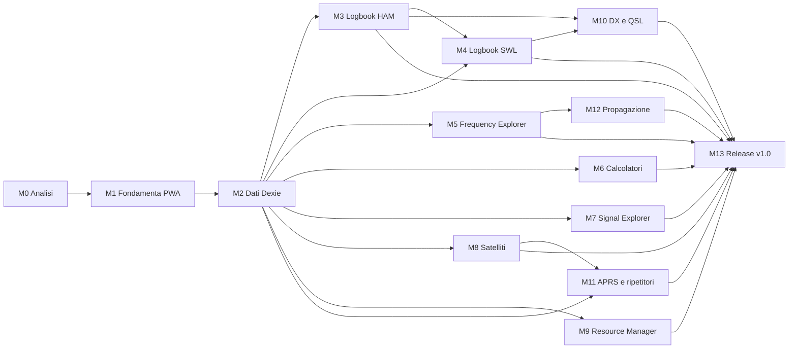

# Roadmap e backlog — Ham Radio Toolbox v1

| Campo                | Valore                                                                                                                                                                              |
| -------------------- | ----------------------------------------------------------------------------------------------------------------------------------------------------------------------------------- |
| Stato                | M0 — Bozza per approvazione                                                                                                                                                         |
| Ultimo aggiornamento | 2026-10-17                                                                                                                                                                          |
| Capacità             | 10–12 h/settimana · 16 settimane · ≈ 160–190 h                                                                                                                                      |
| Documenti collegati  | [Requisiti](../requirements/REQUIREMENTS.md) · [Architettura](../architecture/ARCHITECTURE.md) · [Database](../architecture/DATABASE.md) · [Fonti dati](../data-sources/SOURCES.md) |

La pianificazione è provvisoria (PROJECT §10): va raffinata all'inizio di ogni milestone stimando i task del backlog.

---

## 1. Dipendenze fra milestone

**Cammino critico**: M1 → M2 → M3 → M4 → M10 → M13. M4 dipende da M3 per i componenti condivisi (form di frequenza/ora UTC, allegati, pattern di import/export). M11 riusa l'integrazione Leaflet introdotta in M8. Le milestone si eseguono **in ordine** (`CLAUDE.md`), anche quando le dipendenze consentirebbero il parallelismo.

---

## 2. Calendario indicativo

| Sett. | Milestone                                                | Durata | Ore stimate |
| ----- | -------------------------------------------------------- | ------ | ----------- |
| 1     | M0 Requisiti, architettura, ADR, modello dati, backlog   | 1      | 10          |
| 2     | M1 Setup Vue/TS/Vite, PWA, layout, dashboard             | 1      | 12          |
| 3–4   | M2 IndexedDB, Dexie, repository, migrazioni, core domain | 1,5    | 16          |
| 4–6   | M3 HAM Logbook + ADIF                                    | 2      | 22          |
| 6–7   | M4 SWL Logbook                                           | 1      | 12          |
| 7–8   | M5 Frequency Explorer + EiBi/HFCC                        | 1,5    | 16          |
| 9     | M6 Calcolatori RF e locator                              | 1      | 10          |
| 10    | M7 Signal Explorer                                       | 0,5    | 6           |
| 10–11 | M8 Satellite Explorer                                    | 1,5    | 18          |
| 12    | M9 Resource Manager + Raindrop                           | 1      | 10          |
| 13    | M10 DX Cluster e QSL                                     | 1      | 12          |
| 14    | M11 APRS e ripetitori                                    | 1      | 10          |
| 14–15 | M12 Propagazione                                         | 0,5    | 6           |
| 15–16 | M13 Test, backup, sicurezza, ottimizzazione, release     | 1,5    | 18          |
|       | **Totale**                                               | **16** | **≈ 178**   |

Margine: nessuno esplicito; i requisiti _Should/Could_ sono il cuscinetto (si tagliano per primi).

---

## 3. Milestone

Ogni milestone richiede (PROJECT §10): perimetro documentato, task, criteri di accettazione, test automatici pertinenti, documentazione aggiornata, build di produzione riuscita. Criterio comune a tutte da M1 in poi: **`typecheck`, `lint`, `test` e `build` verdi in CI**.

### M0 — Analisi e progettazione ✅ (in approvazione)

- **Obiettivo**: requisiti, architettura, ADR, modello dati, casi d'uso, fonti dati, backlog.
- **Deliverable**: `docs/requirements/REQUIREMENTS.md`, `docs/architecture/ARCHITECTURE.md`, `docs/architecture/DATABASE.md`, `docs/data-sources/SOURCES.md`, `docs/roadmap/ROADMAP.md`, `docs/adr/0001…0011`, README, aggiornamento `CLAUDE.md`.
- **Criteri di accettazione**: vedi [§ 5 Checklist M0](#5-checklist-di-completamento-m0).

### M1 — Fondamenta PWA e dashboard

- **Dipende da**: M0 approvata e committata.
- **Obiettivo**: app shell installabile e offline, struttura cartelle, qualità e CI.
- **Requisiti**: FR-GEN-01, FR-GEN-07, FR-DSH-01..04, 06, 08, NFR-OFF-02, NFR-MNT-01/02/04, NFR-I18N-01.
- **Criteri di accettazione**:
  - `npm run dev|build|preview|typecheck|lint|format|test|test:e2e` funzionanti come in `CLAUDE.md`.
  - Lighthouse: PWA installabile; manifest e icone validi.
  - Con rete disattivata (Playwright `setOffline`) l'app si apre e tutte le route dei 14 moduli sono navigabili.
  - Toast di aggiornamento funzionante (test manuale con due build).
  - Regole ESLint di layer attive e verificate da un test negativo.
  - Nessuna stringa UI hardcoded (regola lint o controllo in CI).
  - Checklist manuale su tablet Android: installazione, avvio offline.

### M2 — Persistenza e core domain

- **Dipende da**: M1.
- **Obiettivo**: database Dexie v1, repository base, transazioni, migrazioni, backup/restore di base, domain condiviso.
- **Requisiti**: FR-GEN-03/04, FR-SET-01 (dati), FR-SET-03/05/06/07 (base), NFR-REL-01..04; `core/frequency`, `core/locator`, `core/time`, `core/callsign`, `core/reports`.
- **Criteri di accettazione**:
  - Schema v1 come [DATABASE.md § 5](../architecture/DATABASE.md#5-definizione-dexie-riferimento-per-m2), ADR-0006 e ADR-0009 accettati.
  - Test di integrazione dei repository con `fake-indexeddb` (CRUD, cascate, transazioni con rollback).
  - Test unitari: band plan (limiti di ogni banda HF/VHF/UHF), Maidenhead ↔ WGS84 (4/6/8 caratteri, casi ai bordi), distanza/azimut (valori di riferimento), validazione nominativi, RST/SINPO.
  - Backup → restore round-trip identico su tutte le tabelle v1.
  - Stato storage e persistenza visibili in Impostazioni.

### M3 — HAM Logbook + ADIF

- **Dipende da**: M2.
- **Requisiti**: FR-HAM-01..15, FR-QSL-05 (campi), FR-SET-01/02 (UI profilo), UC-01/02/03.
- **Criteri di accettazione**:
  - CRUD QSO con validazioni, banda derivata, duplicati.
  - Import ADIF: fixture reali anonimizzate (export di almeno 2 software diversi), report errori, rollback su errore simulato.
  - Export ADIF valido; round-trip senza perdita dei campi supportati e di `adifExtra`.
  - Lista fluida con 50 000 QSO (misura documentata).
  - E2E: inserimento QSO, ricarica pagina, ricerca, export.

### M4 — SWL Logbook

- **Dipende da**: M2, M3.
- **Requisiti**: FR-SWL-01..08, UC-04.
- **Criteri di accettazione**: 7 categorie con schemi discriminati testati; avviso riservatezza per aeronautica/marittima; export CSV (con protezione formula injection) e JSON; allegati audio entro i limiti; E2E inserimento e filtro.

### M5 — Frequency Explorer + EiBi/HFCC

- **Dipende da**: M2.
- **Requisiti**: FR-FRQ-01..09, FR-GEN-02, FR-DSH-05, FR-SET-08, FR-SWL-09 (broadcast), UC-05.
- **Criteri di accettazione**: ri-verifica di EiBi/HFCC in `SOURCES.md`; parser EiBi testato su un estratto reale (con attribuzione); query "in onda ora" corretta su fasce a cavallo della mezzanotte e giorni della settimana; sostituzione atomica del dataset; provenienza visibile; consultazione offline (E2E). HFCC consegnato o rinviato con motivazione documentata.

### M6 — Calcolatori RF e locator

- **Dipende da**: M2 (domain `core/locator`, `core/units`).
- **Requisiti**: FR-RFC-01..12, UC-13.
- **Criteri di accettazione**: ogni calcolatore con test numerici e valori di riferimento citati nel test; validazione input; funzionamento offline; accessibilità dei form.

### M7 — Signal Explorer

- **Dipende da**: M2.
- **Requisiti**: FR-SIG-01..06.
- **Criteri di accettazione**: catalogo iniziale redatto in proprio (versionato in JSON) con link SigIDWiki; licenza SigIDWiki verificata o contenuti limitati a link; ricerca e filtri testati.

### M8 — Satellite Explorer

- **Dipende da**: M2.
- **Requisiti**: FR-SAT-01..11, UC-06/07.
- **Criteri di accettazione**: download CelesTrak con rate limit e gestione 403/404; import TLE/OMM con checksum; import SatNOGS JSON; previsioni SGP4 confrontate con valori di riferimento (es. passaggi ISS calcolati con uno strumento indipendente, documentati nel test); avvisi di età dei dati; calcolo in Web Worker; mappa Leaflet online + vista polare offline.

### M9 — Resource Manager + Raindrop

- **Dipende da**: M2.
- **Requisiti**: FR-RES-01..10, UC-08.
- **Criteri di accettazione**: import della fixture anonimizzata (struttura identica a `Ham_Radio.html`) e test manuale con il file reale; test di sicurezza (HTML con `<script>`, `javascript:` URL, attributi `on*`) senza esecuzione; duplicati; export.

### M10 — DX Cluster e QSL Manager

- **Dipende da**: M3, M4.
- **Requisiti**: FR-DXC-01..06, FR-QSL-01..06, FR-SWL-10, UC-10/11.
- **Criteri di accettazione**: stati QSL e transizioni testati; import conferme LoTW/eQSL da ADIF con abbinamento ± tolleranza; statistiche; DX: link oppure integrazione nativa solo con termini verificati e ADR; spot purgati dopo 24 h.

### M11 — APRS e Repeater Explorer

- **Dipende da**: M2, M8 (Leaflet).
- **Requisiti**: FR-APR-01..04, FR-RPT-01..06, UC-12.
- **Criteri di accettazione**: catalogo ripetitori con toni in decimi di Hz; ricerca per distanza testata; import/export CSV; link esterni verificati; geolocalizzazione solo su richiesta.

### M12 — Propagazione e servizi esterni

- **Dipende da**: M5 (pattern provider/freschezza).
- **Requisiti**: FR-PRP-01..07, UC-09.
- **Criteri di accettazione**: ADR-0010 deciso; distinzione osservato/previsione in UI e in DB; cache con età; offline con ultimi valori; banner HamQSL con attribuzione.

### M13 — Test, backup, sicurezza, ottimizzazione, release v1.0

- **Dipende da**: tutte.
- **Requisiti**: FR-SET-04..10, tutti gli NFR, criteri di [Requisiti § 7](../requirements/REQUIREMENTS.md#7-criteri-di-accettazione-della-v10).
- **Criteri di accettazione**: Definition of Done di PROJECT §12 interamente soddisfatta; audit di accessibilità (axe + manuale); revisione sicurezza (CSP, import non fidati, dipendenze); budget prestazioni verificati su tablet; documentazione utente; release `1.0.0` taggata e pubblicata.

---

## 4. Backlog

ID `BL-<milestone>-<NN>`. Stima in ore (h). Priorità come nei requisiti. Stato: ☐ da fare · ◐ in corso · ☑ fatto.

### M0

| ID       | Task                                              | Req. | Pri. | h   | Stato |
| -------- | ------------------------------------------------- | ---- | ---- | --- | ----- |
| BL-M0-01 | Verifica coerenza PROJECT/CLAUDE/repository       | —    | M    | 1   | ☑     |
| BL-M0-02 | Requisiti funzionali e non funzionali, casi d'uso | —    | M    | 3   | ☑     |
| BL-M0-03 | Architettura e struttura cartelle                 | —    | M    | 2   | ☑     |
| BL-M0-04 | Modello dati e schema Dexie v1                    | —    | M    | 2   | ☑     |
| BL-M0-05 | Verifica fonti dati (CORS, HTTPS, licenze)        | —    | M    | 1,5 | ☑     |
| BL-M0-06 | ADR 0001–0011                                     | —    | M    | 1   | ☑     |
| BL-M0-07 | Roadmap, backlog, README, aggiornamento CLAUDE.md | —    | M    | 0,5 | ☑     |
| BL-M0-08 | Revisione e approvazione da parte del maintainer  | —    | M    | —   | ☐     |

### M1

| ID       | Task                                                                                                | Req.               | Pri. | h   |
| -------- | --------------------------------------------------------------------------------------------------- | ------------------ | ---- | --- |
| BL-M1-01 | Pulizia `.gitignore` (riga `*.local` duplicata), protezione branch `main`                           | D-09, D-10         | M    | 0,5 |
| BL-M1-02 | Rimozione scaffold Vite; `index.html` con `lang="it"`, titolo, meta PWA                             | D-06, D-07         | M    | 0,5 |
| BL-M1-03 | `tsconfig`: `noUncheckedIndexedAccess`, alias `@/`                                                  | D-18               | M    | 0,5 |
| BL-M1-04 | ESLint flat config + Prettier + regole di layer + script npm                                        | D-02, D-04         | M    | 1,5 |
| BL-M1-05 | Vitest (jsdom) + Playwright config, test di esempio reali (non placeholder)                         | —                  | M    | 1   |
| BL-M1-06 | Tailwind v4 + design token chiaro/scuro                                                             | FR-DSH-06          | M    | 1   |
| BL-M1-07 | i18n tipizzato (ADR-0008)                                                                           | NFR-I18N-01        | M    | 1   |
| BL-M1-08 | Router con route lazy per i 14 moduli e vista "In sviluppo"                                         | FR-GEN-07          | M    | 1   |
| BL-M1-09 | Layout responsive, navigazione, indicatore online/offline                                           | FR-DSH-04          | M    | 1,5 |
| BL-M1-10 | Dashboard: griglia moduli, workspace HAM/SWL, orologio UTC, preferiti (in memoria/`settings` da M2) | FR-DSH-01/02/03/07 | M    | 1,5 |
| BL-M1-11 | `vite-plugin-pwa`: manifest, icone, precache, prompt di aggiornamento                               | FR-DSH-08          | M    | 1,5 |
| BL-M1-12 | GitHub Actions: typecheck, lint, test, build, E2E                                                   | NFR-MNT-04         | M    | 1   |
| BL-M1-13 | Decisione hosting (ADR-0011) e primo deploy                                                         | Q-01               | M    | 0,5 |

### M2

| ID       | Task                                                              | Req.         | Pri. | h   |
| -------- | ----------------------------------------------------------------- | ------------ | ---- | --- |
| BL-M2-01 | `core/frequency`: Hz, conversioni, band plan IARU R1 + test       | FR-HAM-02    | M    | 2   |
| BL-M2-02 | `core/locator`: Maidenhead ↔ WGS84, distanza, azimut + test       | FR-RFC-09/10 | M    | 2   |
| BL-M2-03 | `core/time`, `core/callsign`, `core/reports` (RST/SINPO) + test   | FR-HAM-04    | M    | 1,5 |
| BL-M2-04 | Schemi Zod comuni (`core/validation`)                             | —            | M    | 1   |
| BL-M2-05 | `AppDatabase` v1, repository base, `UnitOfWork`, `fake-indexeddb` | —            | M    | 3   |
| BL-M2-06 | Integrità referenziale e test di cascata                          | —            | M    | 1,5 |
| BL-M2-07 | Pipeline di import generica (preview/commit/job)                  | FR-GEN-03    | M    | 2   |
| BL-M2-08 | Backup/restore JSON v1 + test round-trip                          | FR-SET-05/06 | M    | 2   |
| BL-M2-09 | Impostazioni: storage, persistenza, profilo stazione (dati)       | FR-SET-01/03 | M    | 1   |

### M3

| ID       | Task                                                | Req.            | Pri. | h   |
| -------- | --------------------------------------------------- | --------------- | ---- | --- |
| BL-M3-01 | Domain QSO, schema, regole duplicati                | FR-HAM-02..06   | M    | 2   |
| BL-M3-02 | Form QSO (frequenza kHz/MHz, ora UTC, RST per modo) | FR-HAM-01/04/05 | M    | 4   |
| BL-M3-03 | Lista virtualizzata, ricerca, filtri                | FR-HAM-07/08    | M    | 3   |
| BL-M3-04 | Parser ADIF + test (fixture anonimizzate)           | FR-HAM-09       | M    | 4   |
| BL-M3-05 | Writer ADIF + round-trip                            | FR-HAM-10       | M    | 2   |
| BL-M3-06 | Mapping campi QSL ADIF → `qsl_records`              | FR-QSL-05       | M    | 1,5 |
| BL-M3-07 | Statistiche base                                    | FR-HAM-11       | M    | 2   |
| BL-M3-08 | Profili stazione multipli (UI)                      | FR-HAM-14       | S    | 1,5 |
| BL-M3-09 | Allegati QSO                                        | FR-HAM-12       | S    | 1   |
| BL-M3-10 | Valutazione `cty.dat` per DXCC (Q-06)               | FR-HAM-11       | S    | 1   |

### M4–M13 (da dettagliare all'avvio della milestone)

| ID        | Task                                                           | Req.                 | Pri. | h   |
| --------- | -------------------------------------------------------------- | -------------------- | ---- | --- |
| BL-M4-01  | Schemi discriminati delle 7 categorie + form dinamico          | FR-SWL-01..04        | M    | 5   |
| BL-M4-02  | Filtri, statistiche, export CSV/JSON                           | FR-SWL-06..08        | M    | 4   |
| BL-M4-03  | Allegati audio con limiti                                      | FR-SWL-05            | S    | 2   |
| BL-M5-01  | Ri-verifica fonti EiBi/HFCC; parser EiBi + test                | FR-FRQ-01            | M    | 4   |
| BL-M5-02  | Gestione dataset per stagione                                  | FR-FRQ-03            | M    | 2   |
| BL-M5-03  | Query "in onda ora", ricerca e filtri                          | FR-FRQ-04/05         | M    | 4   |
| BL-M5-04  | Contratto `ProviderDescriptor`/registry + pannello freschezza  | FR-GEN-02, FR-DSH-05 | M    | 2   |
| BL-M5-05  | Parser HFCC                                                    | FR-FRQ-02            | S    | 3   |
| BL-M5-06  | Memorie di frequenza personali                                 | FR-FRQ-07            | S    | 1   |
| BL-M6-01  | Calcolatori 01–08 + test numerici                              | FR-RFC-01..08        | M    | 6   |
| BL-M6-02  | UI locator/distanza/UTC                                        | FR-RFC-09..11        | M    | 3   |
| BL-M7-01  | Catalogo segnali JSON + vista e filtri                         | FR-SIG-01..04        | M    | 5   |
| BL-M8-01  | Provider CelesTrak + import TLE/OMM                            | FR-SAT-02/03         | M    | 4   |
| BL-M8-02  | Import SatNOGS                                                 | FR-SAT-04            | M    | 2   |
| BL-M8-03  | Passaggi SGP4 in worker + test di riferimento                  | FR-SAT-05/06/10      | M    | 6   |
| BL-M8-04  | Leaflet ground track + vista polare                            | FR-SAT-07            | S    | 4   |
| BL-M9-01  | Parser Raindrop sicuro + fixture anonimizzata                  | FR-RES-02/03         | M    | 3   |
| BL-M9-02  | Catalogo, categorie, duplicati, ricerca                        | FR-RES-01/04/05/06   | M    | 5   |
| BL-M10-01 | QSL Manager (stati, statistiche, import conferme)              | FR-QSL-01..05        | M    | 7   |
| BL-M10-02 | DX Cluster: link + (se approvato) provider DX Summit           | FR-DXC-*             | M/S  | 4   |
| BL-M11-01 | Catalogo ripetitori, distanza, CSV                             | FR-RPT-01/02/04      | M    | 6   |
| BL-M11-02 | APRS: link e segnalibri                                        | FR-APR-*             | M    | 2   |
| BL-M12-01 | ADR-0010, provider SWPC, cache osservato/previsione            | FR-PRP-01..03/07     | M    | 4   |
| BL-M12-02 | Banner HamQSL e risorse                                        | FR-PRP-04..06        | M    | 2   |
| BL-M13-01 | Audit accessibilità e prestazioni su tablet                    | NFR-ACC, NFR-PERF    | M    | 5   |
| BL-M13-02 | Revisione sicurezza (CSP, import, dipendenze)                  | NFR-SEC              | M    | 3   |
| BL-M13-03 | Backup/restore completo (tutte le tabelle, allegati, versioni) | FR-SET-05/06         | M    | 4   |
| BL-M13-04 | Documentazione utente, pagina Informazioni, release 1.0.0      | FR-SET-10            | M    | 6   |

---

## 5. Checklist di completamento M0

| #   | Criterio                                                                                    | Esito                                                                                                       |
| --- | ------------------------------------------------------------------------------------------- | ----------------------------------------------------------------------------------------------------------- |
| 1   | Verifica di coerenza fra `PROJECT.md`, stack e repository documentata                       | ✅ [Architettura § 13](../architecture/ARCHITECTURE.md#13-verifica-di-coerenza-progetto--stack--repository) |
| 2   | Requisiti funzionali per i 14 moduli, con ID, priorità e milestone                          | ✅ [Requisiti § 4](../requirements/REQUIREMENTS.md#4-requisiti-funzionali)                                  |
| 3   | Requisiti non funzionali misurabili                                                         | ✅ [Requisiti § 6](../requirements/REQUIREMENTS.md#6-requisiti-non-funzionali)                              |
| 4   | Casi d'uso principali                                                                       | ✅ 15 casi d'uso, [Requisiti § 5](../requirements/REQUIREMENTS.md#5-casi-duso-principali)                   |
| 5   | Architettura a layer, struttura cartelle, porte, PWA, sicurezza, test                       | ✅ [ARCHITECTURE.md](../architecture/ARCHITECTURE.md)                                                       |
| 6   | Modello dati per tutte le entità di PROJECT §7, schema Dexie v1, migrazioni, import, backup | ✅ [DATABASE.md](../architecture/DATABASE.md)                                                               |
| 7   | Fonti esterne verificate (endpoint, HTTPS, CORS, licenza, auth, fallback)                   | ✅ con voci ⚠️ da chiudere nelle milestone indicate ([SOURCES.md](../data-sources/SOURCES.md))              |
| 8   | ADR per le decisioni rilevanti                                                              | ✅ 0001–0011 (alcuni _Proposti_, da decidere in M1/M2/M12)                                                  |
| 9   | Roadmap con dipendenze e backlog stimato                                                    | ✅ questo documento                                                                                         |
| 10  | README e `CLAUDE.md` allineati alla struttura documentale                                   | ✅                                                                                                          |
| 11  | Nessuna funzionalità di milestone successive implementata                                   | ✅ nessun file in `src/` modificato                                                                         |
| 12  | Approvazione del maintainer                                                                 | ☐ in attesa                                                                                                 |
